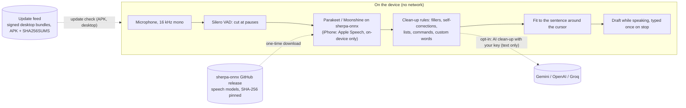

<p align="center"></p>

<h1 align="center">Humming Keyboard</h1>

<p align="center"><strong>Talk, and it types. Offline by default: your voice stays on your device.</strong><br>
A private keyboard with offline voice typing for Android, plus iPhone, Windows, macOS and Linux apps.</p>

<p align="center">
<a href="https://github.com/muhib-karim/humming-keyboard/releases"></a>
<a href="https://github.com/muhib-karim/humming-keyboard/actions/workflows/keyboard.yml"></a>
<a href="https://github.com/muhib-karim/humming-keyboard/actions/workflows/desktop.yml"></a>
<a href="https://github.com/muhib-karim/humming-keyboard/actions/workflows/ios.yml"></a>
<a href="https://github.com/muhib-karim/humming-keyboard/actions/workflows/release.yml"></a>
<br>
<a href="#install"></a>
<a href="#benchmarks"></a>
<a href="LICENSE"></a>
</p>

<p align="center">
<a href="https://muhib-karim.github.io/humming-keyboard/"><strong>Website</strong></a> ·
<a href="https://github.com/muhib-karim/humming-keyboard/releases/latest"><strong>Download</strong></a> ·
<a href="docs/USER_GUIDE.md"><strong>User guide</strong></a> ·
<a href="COMPETITORS.md"><strong>Compare</strong></a> ·
<a href="CHANGELOG.md"><strong>Changelog</strong></a> ·
<a href="https://muhib-karim.github.io/humming-keyboard/privacy.html"><strong>Privacy</strong></a>
</p>

| Android: tap, talk, it types | iPhone: talk, clean text | Desktop: hold a shortcut anywhere |
|:---:|:---:|:---:|
|  |  |  |

<sub>Captures from earlier CI runs (Android emulator in airplane mode, iOS simulator, the desktop interface) playing a
sample sentence, because CI machines have no microphone. Sample text is made up.</sub>

## The problem

Voice typing is the fastest way to write on a phone, but the popular options make you choose. The dictation apps
that clean up speech well, such as Wispr Flow and Aqua Voice, run in the cloud only, so your voice leaves the device,
and their free tiers cap the words you may dictate. Gboard's offline voice typing needs a Pixel 6 or later. Gboard,
SwiftKey and Apple publish no accuracy figure, and the dictation apps that do measure on their own test sets.

## What Humming does

Humming types what you say, on the device, on Android, iPhone, Windows, macOS and Linux.

- **Offline by default.** NVIDIA Parakeet models on sherpa-onnx (Android, desktop) and Apple's recogniser with
  on-device recognition required (iPhone). Speech is never sent to a server unless you switch on an opt-in online
  feature ([Privacy](#privacy)).
- **Clean text, not a transcript.** Fillers, stutters and self-corrections are removed ("3, no, 4pm" becomes "4pm");
  "bullet point" starts a list, "scratch that" drops the last sentence, and custom words can replace what the
  recogniser heard (`cube cuddle -> kubectl`). The same rules run on all three platforms.
- **No length limit, no word cap, no account.** Text appears as an underlined draft while you speak and is typed once
  when you stop; dictation keeps going with the screen off.
- **A full keyboard on Android**, built on FlorisBoard: prediction in six languages, glide typing, Bangla phonetic
  typing, emoji search, clipboard history, themes, one-handed, floating and split layouts.
- **Free and open source** under Apache-2.0, with no ads and no analytics.

What is new in each release: [CHANGELOG.md](CHANGELOG.md).

## Benchmarks

Word error rate (WER: the share of words the recogniser gets wrong; lower is better) on LibriSpeech, with the exact
model files, SHA-256 pins and decoder settings the apps ship. Measured by
[`wer-bench.yml`](.github/workflows/wer-bench.yml) on the v1.7.0 release commit `e1bc3bb`, run
[39053406494](https://github.com/muhib-karim/humming-keyboard/actions/runs/39053406494), 17 October 2026, 2 CPU threads
per machine. The sample is fixed (the first 200 test-clean and 100 test-other utterances by ID), so read WER as ±0.5
points. Raw output for each machine: [`docs/bench/ci-39053406494-*`](docs/bench/).

| Model (download) | WER test-clean | WER test-other | Median time to text, test-clean | Real-time factor |
|---|---:|---:|---:|---:|
| **Fast**, default: Parakeet TDT-CTC 110M int8 (104 MB) | 2.74 - 2.91 % | 4.07 - 4.26 % | 99 - 193 ms | 0.014 - 0.027 |
| **Best**: Parakeet TDT 0.6B v2 int8 (482 MB) | 1.66 - 1.79 % | 3.06 - 3.25 % | 337 - 671 ms | 0.047 - 0.091 |
| **Lite**, desktop only: Moonshine tiny int8 (30 MB) | 4.49 - 4.57 % | 11.78 - 12.03 % | 85 - 134 ms | 0.011 - 0.018 |

Ranges span the four machines; per machine:

| Machine (GitHub runner) | CPU | Fast clean / other | Best clean / other | Lite clean / other |
|---|---|---:|---:|---:|
| Linux x64 (`ubuntu-22.04`) | AMD EPYC 7763 | 2.74 / 4.20 % | 1.68 / 3.12 % | 4.49 / 12.03 % |
| Linux arm64 (`ubuntu-24.04-arm`) | aarch64 | 2.91 / 4.07 % | 1.66 / 3.18 % | 4.53 / 11.78 % |
| macOS (`macos-14`) | Apple M1 (virtual) | 2.76 / 4.26 % | 1.79 / 3.25 % | 4.57 / 11.97 % |
| Windows x64 (`windows-2022`) | Intel Xeon Platinum 8573C | 2.87 / 4.07 % | 1.77 / 3.06 % | 4.51 / 11.97 % |

The apps and the badge quote the earlier CI run
[37204875974](https://github.com/muhib-karim/humming-keyboard/actions/runs/37204875974) (4 October 2026, AMD EPYC 9V74):
Fast 2.78 %, Best 1.68 % on test-clean ([`docs/bench/ci-37204875974-wer.json`](docs/bench/ci-37204875974-wer.json)); a
unit test on Android and desktop keeps them equal to that file. Speed is desktop-CPU speed: phone latency has not been
benchmarked, so none is claimed.

**Reproduce it** (one command, on your own fork's Actions; models and audio are downloaded and SHA-256 checked):

```sh
gh workflow run wer-bench.yml -f n_clean=200 -f n_other=100
```

Locally, with `pip install sherpa-onnx==1.13.8 jiwer soundfile` and the three model folders from the workflow's
"Models" step in `m/`: `python keyboard/ci/fetch_librispeech_sample.py bench test-clean 200`, then
`python keyboard/ci/wer_bench.py m bench/LibriSpeech wer.json 200 0`.

**Published by vendors, not measured by us.** These use other test sets and are not comparable with the table above:
Superwhisper S1-Voice 6.6 % WER on Superwhisper's own 8-set English benchmark
([superwhisper.com/benchmarks](https://superwhisper.com/benchmarks)); Aqua Voice Avalon 1.5 5.55 %, test set not
stated ([aquavoice.com/llms.txt](https://aquavoice.com/llms.txt)); Wispr Flow 8.7 % "raw", measured by Superwhisper, a
competitor ([superwhisper.com/benchmarks/wispr-flow-raw](https://superwhisper.com/benchmarks/wispr-flow-raw)).
Gboard, SwiftKey and Apple publish no WER. Sources checked 17 October 2026; all of them are in
[COMPETITORS.md](COMPETITORS.md).

## Architecture



| Directory | What it is |
|---|---|
| [`keyboard/`](keyboard/) | Android keyboard: a fork of FlorisBoard v0.5.2 (Kotlin, Jetpack Compose). Humming's code is in `com.humming.keyboard`; changes to upstream are listed in [`keyboard/NOTICE-HUMMING.md`](keyboard/NOTICE-HUMMING.md). |
| [`desktop/`](desktop/) | Windows, macOS and Linux app (Tauri v2: Rust back end, TypeScript UI). |
| [`ios/`](ios/) | iPhone and iPad app and keyboard extension (SwiftUI); clean-up rules in the `HummingCore` Swift package. |
| [`core/`](core/) | Shared Rust crate (VAD, audio helpers, clean-up, spoken lists). |
| [`play/`](play/) | Website (`play/site/`), privacy policy, Google Play listing material. |
| [`scripts/`](scripts/) | Release assembly, update-signature verification, site checks (Python). |
| [`docs/`](docs/) | User guide, architecture, benchmark outputs, audits, screenshots. |

Module by module, the dictation pipeline, the update channel and CI: [docs/ARCHITECTURE.md](docs/ARCHITECTURE.md);
a file-level map: [docs/ci/CODEBASE_MAP.md](docs/ci/CODEBASE_MAP.md).

## How Humming compares

| | **Humming** | Gboard | Microsoft SwiftKey | Ridmik (Bangla) |
|---|---|---|---|---|
| Offline voice typing | **Yes**, default, every platform (English) | Pixel 6 or later, 6 languages | Not in the stable app; an on-device English mode is reported in a beta | No, uses Google's speech service |
| Published accuracy | **WER 2.78 % / 1.68 %** (above) | Not published | Not published | Not published |
| Telemetry | **None** | Usage statistics; federated learning on by default | Typing data opt-in; voice clips opt-out | Play label: may collect personal info and IDs |
| Desktop app | **Windows, macOS, Linux** | No | No | No |
| Price / ads | **Free, no ads** | Free | Free; ads on Android | Free; ads and IAP on Android |
| Open source | **Apache-2.0** | No | No | No |

| Dictation apps | **Humming** | Wispr Flow | Superwhisper | Aqua Voice | Apple Dictation |
|---|---|---|---|---|---|
| Works offline | **Yes**, default, every platform (English) | No, cloud only | Yes, local models | No, cloud only | On-device in many languages |
| Fillers, lists, "scratch that", replacements | **All four** | All four | Fillers, lists, replacements | Replacements | "Delete" / "undo" on iPhone (US English) |
| Edit existing text by voice | No | Command Mode (Pro, desktop) | On selected text | Edit Mode | iPhone, US English |
| Linux | **Yes** | No | "Coming soon" | No | No |
| Price | **Free, no word cap** | Free 2,000 words/week; $15/month | Free with local models; $8.49/month | Free 1,000 words; $10/month | Free with the OS |

Public sources only, checked 17 October 2026; every source, Fleksy, Typewise, Avro, Bijoy, Typeless, Willow,
MacWhisper and the ranked gap lists are in [COMPETITORS.md](COMPETITORS.md). **Where Humming trails:** offline voice is
English only; it cannot yet edit text already in the field by voice or adapt tone per app; Gboard and SwiftKey type in
far more languages and install from the stores, while Humming is sideloaded (the iPhone build must be re-signed every
7 days).

## Install

Current release: **[Humming 1.7.0](https://github.com/muhib-karim/humming-keyboard/releases/tag/v1.7.0)**, every file
with a [`SHA256SUMS.txt`](https://github.com/muhib-karim/humming-keyboard/releases/download/v1.7.0/SHA256SUMS.txt). Step-by-step help: [user guide](docs/USER_GUIDE.md).

| Platform | Download | Install |
|---|---|---|
| **Android** 8.0+ | [Humming-1.7.0.apk](https://github.com/muhib-karim/humming-keyboard/releases/download/v1.7.0/Humming-1.7.0.apk) | Open the APK, allow "install unknown apps" for your browser or file manager, install. Open Humming and follow the two steps (enable the keyboard, switch to it). The first mic tap downloads the Fast speech model once (104 MB). |
| **iPhone / iPad** (iOS 16+) | [Humming_1.7.0_unsigned.ipa](https://github.com/muhib-karim/humming-keyboard/releases/download/v1.7.0/Humming_1.7.0_unsigned.ipa) | Sideload with your own free Apple ID (Sideloadly, AltStore or Xcode; re-sign every 7 days), then add the keyboard in Settings > General > Keyboard. Guide: [docs/IOS_SIDELOAD.md](docs/IOS_SIDELOAD.md). |
| **Windows** 10/11 x64 | [setup.exe](https://github.com/muhib-karim/humming-keyboard/releases/download/v1.7.0/Humming_1.7.0_x64-setup.exe) or [.msi](https://github.com/muhib-karim/humming-keyboard/releases/download/v1.7.0/Humming_1.7.0_x64_en-US.msi) | Run the installer. SmartScreen: **More info** > **Run anyway** (unsigned build). |
| **macOS** 11+ (Apple silicon and Intel) | [Humming_1.7.0_universal.dmg](https://github.com/muhib-karim/humming-keyboard/releases/download/v1.7.0/Humming_1.7.0_universal.dmg) | Drag to Applications, open once, then **System Settings > Privacy & Security > Open Anyway**. Allow Microphone and Accessibility. |
| **Linux** x86-64 | [.AppImage](https://github.com/muhib-karim/humming-keyboard/releases/download/v1.7.0/Humming_1.7.0_amd64.AppImage) or [.deb](https://github.com/muhib-karim/humming-keyboard/releases/download/v1.7.0/Humming_1.7.0_amd64.deb) | `chmod +x` the AppImage and run it, or `sudo apt install ./Humming_1.7.0_amd64.deb`. Auto-paste works on X11 and in XWayland apps; on pure Wayland every dictation is kept in History, one click to copy. |

### Verify the Android APK

```sh
sha256sum -c SHA256SUMS.txt --ignore-missing        # the APK's checksum matches the release
apksigner verify --print-certs Humming-1.7.0.apk    # build-tools; check the signer below
# Signer #1 certificate SHA-256 digest:
# 8c8b68bbe63aa42a856159aaa5b0c90cd954eef78a980d39bcb66941753e1fc6
```

The release workflow checks that the APK and the AAB are both signed with this upload certificate (`8C:8B:68:BB:...:3E:1F:C6`, [docs/RELEASE_SIGNING.md](docs/RELEASE_SIGNING.md)); the in-app
updater refuses an APK signed with any other key.

### Updates

| Platform | What happens |
|---|---|
| Windows, macOS, Linux AppImage | Checks 45 s after start and every 4 hours; installs signed updates (minisign, Ed25519) and restarts, never mid-dictation. Turn automatic installation off in Settings > Updates. |
| Linux .deb | Shows that a new version is out (a .deb cannot replace itself). |
| Android APK | Checks at most every 6 hours; downloads on Wi-Fi, verifies SHA-256 and the signing certificate, then Android asks you to confirm. |
| Android (Play bundle) | Updated by Play; no self-updater, no install permission. |
| iPhone / iPad | No automatic updates for a sideloaded app: sideload the new `.ipa`. |

Feeds (`latest.json`, `android.json`) are written by [`scripts/assemble_release.py`](scripts/assemble_release.py) and
mirrored to `https://humming-keyboard.pages.dev/updates/`; release candidates are not mirrored. How a release is cut:
[docs/RELEASING.md](docs/RELEASING.md).

## Privacy

No account, no analytics, no ads, and no cloud speech engine of Humming's own. Full policy:
[privacy policy](https://muhib-karim.github.io/humming-keyboard/privacy.html) (source:
[play/PRIVACY_POLICY.md](play/PRIVACY_POLICY.md)).

- **The offline voice path has no network code.** `NetworkAuditTest` scans every Kotlin and Java source in the app and
  its libraries and fails the unit tests if any file other than `ModelDownload.kt`, `GifSearch.kt`, `LlmCleanup.kt` and
  `AppUpdate.kt` uses a network API; no voice-path file may import `java.net`. It is a check on the code as written,
  not a firewall at run time.
- **Everything that uses the network:**
  1. the one-time speech model download from the sherpa-onnx GitHub release, checked against a pinned SHA-256 (Wi-Fi
     only if you choose);
  2. the update check of the sideloaded APK and the desktop app (on by default; sends no audio, text or identifiers);
  3. GIF search (off by default, off in incognito unless allowed): only the words typed in its search box, to Openverse;
  4. AI clean-up with your own key (off by default, never in incognito): the dictated **text**, never audio;
  5. Online mode (off by default): hands **audio** to the phone's own speech service. Incognito does not switch it off.
- **Android backup**: if Android's device backup is on, Android may copy Humming's settings and personal dictionary
  to your Google account; Humming itself sends nothing.
- **iPhone**: Apple's recogniser with on-device recognition required; the iOS app has no network code.

## Build from source

Requirements and every platform in detail: the per-app READMEs and [docs/RELEASING.md](docs/RELEASING.md).

```sh
# Android (JDK 17, Android SDK platform 36, build-tools 35)
cd keyboard
./gradlew :app:testDebugUnitTest      # unit tests
./gradlew :app:assembleDebug          # debug APK in app/build/outputs/apk/debug/

# Desktop (Node 20+, Rust stable, the platform toolchain)
cd desktop && npm ci && npm run tauri dev

# iOS (macOS, Xcode 16+)
brew install xcodegen && cd ios && xcodegen generate && open Humming.xcodeproj
cd ios/HummingCore && swift test      # clean-up rules, also on Linux
```

The sherpa-onnx Android library is downloaded once during the build and checked against a pinned SHA-256; speech
models are not in the APK. Without the release-signing environment variables, the release build is signed with the
development key ([docs/RELEASE_SIGNING.md](docs/RELEASE_SIGNING.md)).

CI (`.github/workflows/`): `keyboard.yml` (Android tests and APKs), `android-release.yml` (signed APK and AAB),
`desktop.yml` (installers for every desktop platform), `ios.yml` (tests, screenshots, unsigned `.ipa`), `screens.yml`,
`wer-bench.yml`, `release.yml` (a tagged release end to end) and `pages.yml` (website and update mirror).

## Documentation

| Document | Contents |
|---|---|
| [docs/USER_GUIDE.md](docs/USER_GUIDE.md) | Install, enable the keyboard, voice typing, settings, updates, troubleshooting |
| [COMPETITORS.md](COMPETITORS.md) | Teardown against Gboard, SwiftKey, Fleksy, Typewise, Ridmik, Avro, Bijoy and the dictation apps (Wispr Flow, Typeless, Superwhisper, Aqua Voice, Willow, MacWhisper, Apple, Google); ranked gap lists |
| [docs/ARCHITECTURE.md](docs/ARCHITECTURE.md) | Modules, the dictation pipeline, the update channel, CI |
| [docs/BRAND.md](docs/BRAND.md) | Colours, icon, design tokens across Android, desktop, iOS and the site |
| [docs/RELEASING.md](docs/RELEASING.md) | Versioning, signing, release assets, update feeds, tagging |
| [docs/IOS_SIDELOAD.md](docs/IOS_SIDELOAD.md) | Installing the unsigned iOS build |
| [docs/README.md](docs/README.md) | Index of all documentation, audits and CI notes |

## Contributing and security

- [CONTRIBUTING.md](CONTRIBUTING.md): bugs, features and pull requests.
- [SECURITY.md](SECURITY.md): report vulnerabilities privately through GitHub Security Advisories.
- [CODE_OF_CONDUCT.md](CODE_OF_CONDUCT.md): Contributor Covenant 2.1.

## Licence and credits

Humming is licensed under the **Apache License 2.0** ([`LICENSE`](LICENSE), [`NOTICE`](NOTICE)), covering the whole
repository: the Android keyboard (`keyboard/`, which keeps the FlorisBoard copy in
[`keyboard/LICENSE`](keyboard/LICENSE)), the desktop app, the shared core and the iOS app. The repository is public
from the 1.6.3 release.

- **FlorisBoard** (Apache-2.0): the keyboard base. Copyright (C) 2020-2025 The FlorisBoard Contributors; upstream
  licence and headers kept, changes listed in [`keyboard/NOTICE-HUMMING.md`](keyboard/NOTICE-HUMMING.md). Humming is not
  affiliated with the FlorisBoard project. Android keyboard built on FlorisBoard (Apache 2.0).
- **NVIDIA Parakeet** TDT-CTC 110M and TDT 0.6B v2: model weights under **CC-BY-4.0**
  (https://creativecommons.org/licenses/by/4.0/); ONNX int8 export by the sherpa-onnx project, used unmodified.
- **sherpa-onnx** (Apache-2.0, k2-fsa): the speech runtime. **ONNX Runtime** (MIT), **Silero VAD** (MIT), Apache
  Commons Compress (Apache-2.0), the AOSP word lists (Apache-2.0).
- Prediction data: **Tatoeba** sentences (CC BY 2.0 FR) and **Mozilla Common Voice** sentence lists (CC0); only
  aggregated counts and the English neural model `hlm_en.bin` (trained on them; Tatoeba's attribution applies) ship.
- Stickers: rendered from **Noto Emoji** (Apache-2.0) with captions in **Bangers** (OFL-1.1).
- Bangla phonetic rules: written for Humming from the common Avro-style conventions; no Avro code or rule data is
  included.

No GPL code is included in the Android app. [`keyboard/LICENSES.md`](keyboard/LICENSES.md) lists each third-party
component of the Android keyboard; for the desktop app, core and iOS app the dependencies and licences are those
declared in `desktop/src-tauri/Cargo.toml`, `desktop/package.json`, `core/Cargo.toml` and their lock files.
