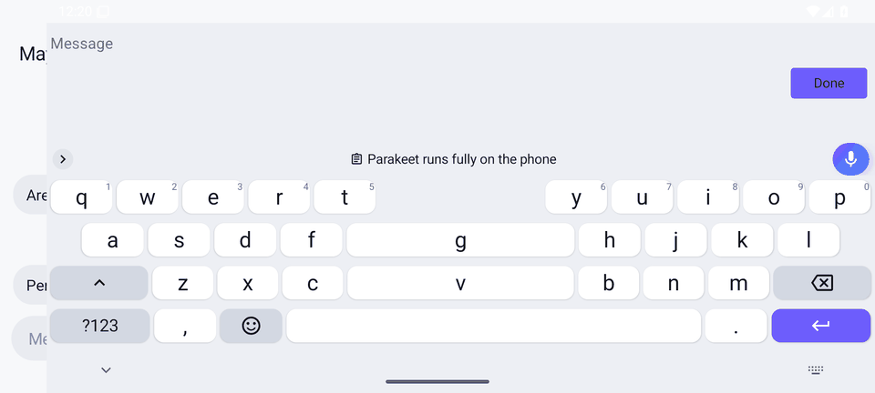

# Humming Keyboard

**A private Android keyboard with offline voice typing that beats FUTO's best model.** You tap the mic and talk.
The words appear in a live preview and land in the text field when you tap Done. The speech model runs on the
phone, so dictation works in airplane mode and your voice never leaves the device.


<p align="center"></p>

*The demo was recorded on a CI Android emulator in airplane mode, with a spoken WAV clip fed in as the microphone.
The middle part is sped up 8x because emulator CPUs are slow. The text is committed only when you tap Done.*

## Features

**Voice**
- Offline dictation on NVIDIA Parakeet, run by sherpa-onnx. Two models:
  - **Fast** (default): Parakeet TDT-CTC 110M int8, a 104 MB download.
  - **Best**: Parakeet TDT 0.6B v2 int8, a 482 MB download. It is offered on phones with 6 GB+ RAM.
- Live preview while you talk. Phrases are cut by Silero VAD. The field gets one clean commit when you tap Done, so
  half-finished words never reach your chat app.
- Clean mode (on by default) removes fillers and stutters. It also applies self-corrections: "ten, no, fifteen
  minutes" becomes "15 minutes", and "scratch that" drops the sentence. Punctuation and capitals come from the model.
- Model manager in Settings > Voice. You can choose Fast or Best, see the size, delete a model and turn on
  **Download on Wi-Fi only**. An **Offline** badge shows on the voice panel once a model is installed.
- Bluetooth headset microphone support.
- Long-press the mic to hand off to **Gboard voice typing** (see below).

**Typing** (built on FlorisBoard)
- Suggestions, autocorrect and next-word predictions. Swipe typing is on by default.
- Clipboard history, on by default: a 2-column grid with timestamps, up to 100 items kept for up to a week.
- Edit shortcuts: long-press a (select all), c (copy), x (cut), v (paste), z (undo) and y (redo). There is also an
  edit toolbar in the suggestion bar.
- Space-bar trackpad: slide to move the cursor left, right, up and down.
- Split keyboard in landscape and on tablets.
- Incognito mode: no learning, no clipboard history and no voice history.
- Humming light and dark themes.

| | | |
|---|---|---|
|  |  |  |
| Settings > Voice: model manager | Clipboard history | Voice panel (dark) |



## Offline by design

- **The voice path has no network code.** Recording, voice detection, recognition, cleanup and history run on the
  phone. A unit test (`NetworkAuditTest`) scans every Kotlin and Java source in the app and its libraries. It fails
  the build if any file other than `ModelDownload.kt` uses a network API (sockets, HTTP, URL connections, WebView,
  DownloadManager). It also checks that no voice-path file even imports `java.net`.
- **The only network use is the one-time model download.** It goes to the sherpa-onnx GitHub release. Each file is
  checked against a pinned SHA-256 and rejected on a mismatch. With **Wi-Fi only** on, the download waits for Wi-Fi.
  After that, dictation needs no connection at all.
- **Proven in CI.** On every push, an Android 15 emulator:
  1. turns on airplane mode and disables Wi-Fi, then checks that there is no default network and that ping fails;
  2. cold-starts the keyboard and dictates a real spoken clip;
  3. commits "Please send the quarterly report to the whole team by Friday afternoon." into the text field.

  Airplane mode is still on at the end. The screenshots, a screen recording and the logs are kept as build artifacts.


There is no cloud speech engine, no account, no analytics and no ads.

## Why Parakeet: the bake-off

Every engine got the same 73 clips: 48 LibriSpeech test-clean and 25 test-other (accents, noise, fast speech).
They were run on a desktop CPU with 2 threads. WER is the word error rate, so lower is better. RTF is decode time
divided by audio length, so lower is faster.

| Engine | WER clean | WER other | WER all | RTF | Download |
|---|---:|---:|---:|---:|---:|
| **Parakeet TDT 0.6B v2 int8 (Humming Best)** | 2.0% | 4.4% | **2.6%** | 0.092 | 482 MB |
| **Parakeet TDT-CTC 110M int8 (Humming Fast)** | 2.6% | 6.6% | **3.7%** | **0.028** | 104 MB |
| FUTO Whisper small.en ACFT q8 (FUTO's biggest) | 3.6% | 10.0% | 5.4% | 0.259 | ~260 MB |
| Whisper base.en q8 (whisper.cpp) | 4.4% | 10.7% | 6.1% | 0.228 | 82 MB |
| FUTO Whisper base.en ACFT q8 | 4.5% | 14.1% | 7.1% | 0.072 | 82 MB |
| FUTO Whisper tiny.en ACFT q8 | 7.9% | 16.3% | 10.2% | 0.032 | 44 MB |

The small Parakeet is more accurate than FUTO's biggest model and about 9x faster. Caveats: this was measured on a
desktop CPU, and phones are roughly 2-4x slower. With 73 clips, gaps under about half a point are noise. FUTO's
models were only benchmarked, never shipped.

## Gboard voice typing hand-off (Rambler)

Gboard's newer voice typing (code-named "Rambler" on Pixel phones) is part of Gboard, which is closed source.
Humming can't embed it, so it offers a switch instead. If Gboard is installed and enabled as a keyboard,
long-pressing Humming's mic shows a menu:

- **Humming**: offline, on this phone.
- **Gboard voice typing**: switches the active keyboard to Gboard through Android's input-method API. If Gboard
  declares a voice subtype, Humming picks that. Otherwise it opens Gboard's keyboard, and Gboard's mic is one tap
  away. Gboard's own keyboard-switch key brings you back to Humming.

| | | |
|---|---|---|
|  |  |  |
| Long-press the mic | Gboard takes over | Back to Humming |

Honest limits:
- The option is hidden when Gboard isn't enabled. A plain tap on the mic always uses Humming.
- The current Gboard declares no voice subtype, so it takes one extra tap on Gboard's mic.
- Gboard voice typing is Google's service. Whether it runs offline or sends audio to Google is set in Gboard and
  Google's settings, not by Humming.
- Humming can't read what you dictated in Gboard, so that text isn't added to Humming's voice history.
- Android lets you come back with Gboard's switch key or the system keyboard picker. Humming can't pull focus back
  by itself.
- CI checks this flow on a Google Play emulator image with Gboard preinstalled (long-press, menu tap, Gboard
  active, back to Humming).

## Build

Requirements: JDK 17 and the Android SDK (platform 36, build-tools 35).

```sh
cd keyboard
./gradlew :app:testDebugUnitTest      # unit tests
./gradlew :app:assembleDebug          # debug APK: app/build/outputs/apk/debug/
./gradlew :app:assembleRelease        # release APK (R8): app/build/outputs/apk/release/
```

The sherpa-onnx Android library (v1.13.8) is downloaded once during the build and checked against a pinned SHA-256.
The speech models aren't part of the APK: the app downloads the one you choose. The release build is signed with
the development key. For a store build, set your own keystore in `keyboard/app/build.gradle.kts`.

CI (`.github/workflows/keyboard.yml`) runs four jobs: unit tests plus the debug APK, the release APK, emulator
screenshots with the offline proof, and the Gboard hand-off run.

**Download:** the APK is attached to the GitHub Release.

## Licence and credits

Humming Keyboard is licensed under the **Apache License 2.0**. See `keyboard/LICENSE`.

- **FlorisBoard** (Apache-2.0): the keyboard base. Copyright (C) 2020-2026 The FlorisBoard Contributors. The
  upstream licence and file headers are kept, and our changes are listed in `keyboard/NOTICE-HUMMING.md`. Humming is
  not affiliated with the FlorisBoard project.
- **NVIDIA Parakeet** TDT-CTC 110M and TDT 0.6B v2: the speech model weights, licensed under
  **CC-BY-4.0** (https://creativecommons.org/licenses/by/4.0/). The ONNX int8 export is by the sherpa-onnx project
  and is used unmodified. The credit is also shown in Settings > Voice.
- **sherpa-onnx** (**Apache-2.0**), by the k2-fsa project: the speech runtime.
- **ONNX Runtime** (MIT), **Silero VAD** (MIT), Apache Commons Compress (Apache-2.0) and the AOSP English word list
  (Apache-2.0).

No GPL code is included. The full list with each obligation is in `keyboard/LICENSES.md`. See `CHANGELOG.md` for
changes.
