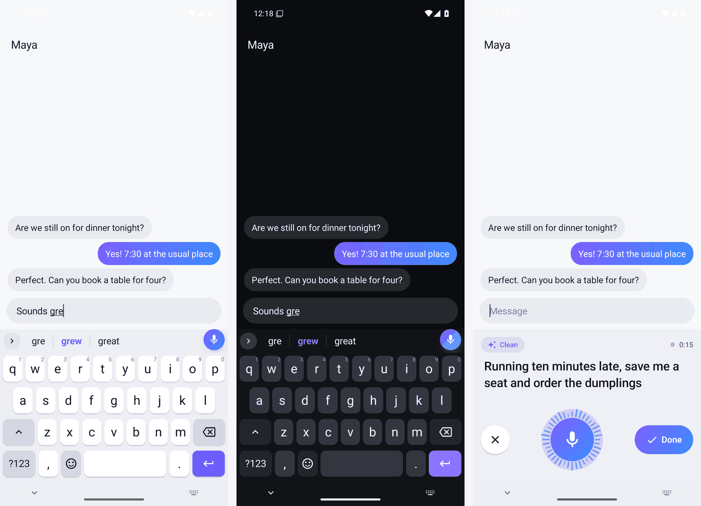
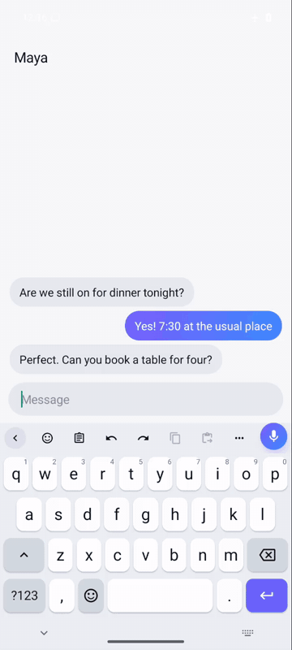
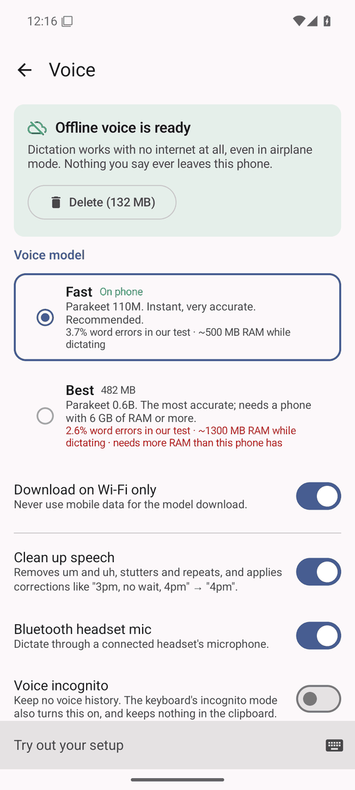
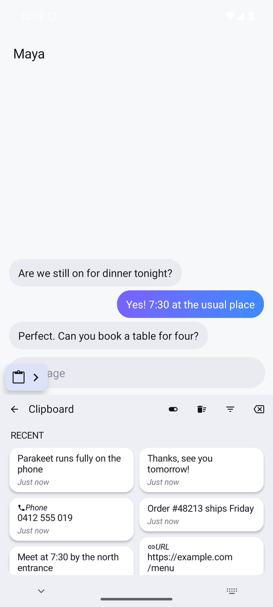
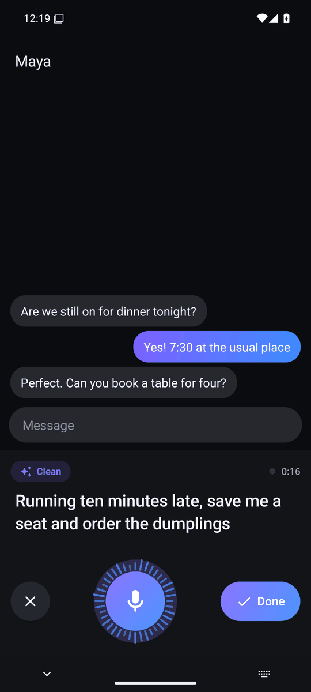
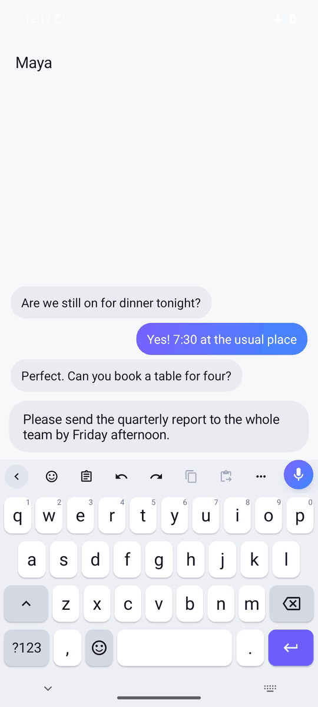
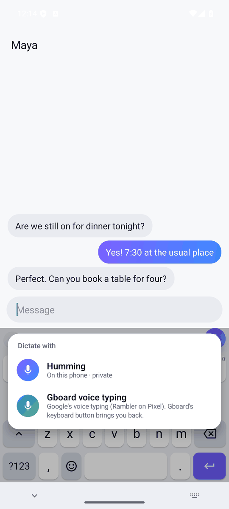
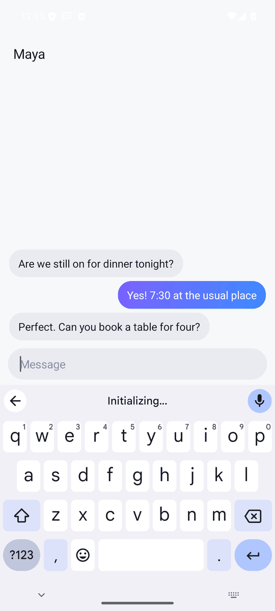
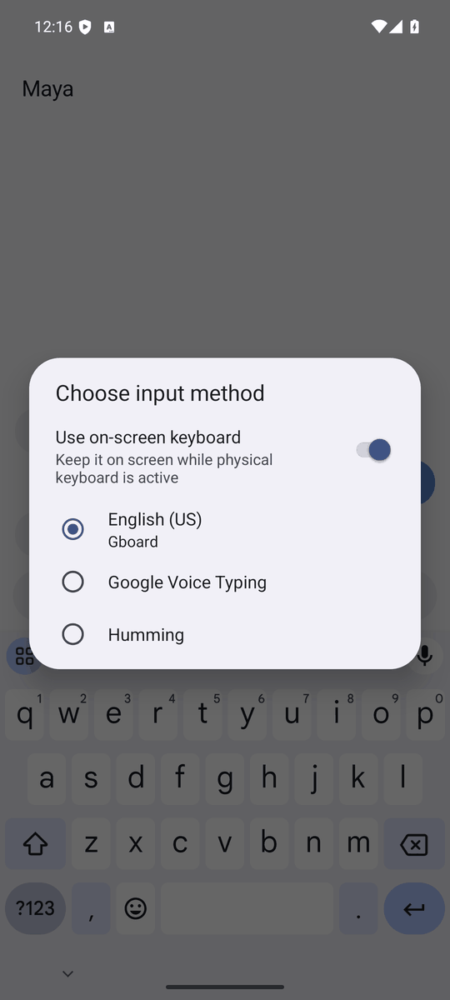

# Humming Keyboard

**A private Android keyboard with offline voice typing that beats FUTO's best model.** You tap the mic and talk.
The words appear in a live preview and land in the text field when you tap Done. The speech model runs on the
phone, so dictation works in airplane mode and your voice never leaves the device.



<p align="center"></p>

*The demo was recorded on a CI Android emulator in airplane mode, with a spoken WAV clip fed in as the microphone.
The middle part is sped up 8x because emulator CPUs are slow. The text is committed only when you tap Done.*

## Features

**Voice**
- Offline dictation on NVIDIA Parakeet, run by sherpa-onnx. Two models:
  - **Fast** (default): Parakeet TDT-CTC 110M int8, a 104 MB download.
  - **Best**: Parakeet TDT 0.6B v2 int8, a 482 MB download. It is offered on phones with 6 GB+ RAM.
- Live preview while you talk. Phrases are cut by Silero VAD. The field gets one clean commit when you tap Done, so
  half-finished words never reach your chat app.
- Clean mode (on by default) removes fillers and stutters. It also applies self-corrections: "ten, no, fifteen
  minutes" becomes "15 minutes", and "scratch that" drops the sentence. Punctuation and capitals come from the model.
- Model manager in Settings > Voice. You can choose Fast or Best, see the size, delete a model and turn on
  **Download on Wi-Fi only**. An **Offline** badge shows on the voice panel once a model is installed.
- Bluetooth headset microphone support.
- Long-press the mic to hand off to **Gboard voice typing** (see below).

**Typing** (built on FlorisBoard)
- **Word prediction that reads like Gboard**: a three-slot strip with the best guess in the middle and what you typed
  in quotes. A 156k-word English dictionary with frequencies, next-word prediction, keyboard-aware autocorrect
  (Off / Mild / Normal / Aggressive), apostrophe fixes (dont → don't) and learning from what you type, on the phone
  only. German, Spanish, French, Italian and Portuguese dictionaries too.
- **On-device neural next-word model** (1.2): a small word-level LSTM (16k words, int8, 2.7 MB) that reads the whole
  sentence so far, run by Humming's own Kotlin code with no native library and no network. Blended with the word
  tables, it lifts held-out next-word top-3 accuracy from 30.2 % to 36.5 % (sentences it never saw;
  measured by a unit test on every build). "Smart prediction strength" in Settings sets the blend or turns it off.
- **Next-word prediction in six languages** (1.2): German, Spanish, French, Italian and Portuguese now suggest the
  next word too (held-out top-3 22-26 %, up from 1-5 %).
- **Stickers & GIFs** (1.2, off until you turn it on): 32 built-in stickers, your own imported images, a search box,
  and optional online GIF search through Openverse (openly licensed GIFs, no account or key) that says exactly what
  it sends and stays off in incognito.
- Emoji in the strip ("pizza" offers 🍕), emoji search with `:heart`, and text shortcuts ("omw" → your phrase).
- Glide (swipe) typing, fed by the same dictionary.
- Number row, long-press symbols, key sound and vibration, one-handed mode, a **floating keyboard** you drag by its
  handle, and a split keyboard in landscape and on tablets.
- Themes: Humming light, dark and AMOLED black, a custom accent colour, and your own **background photo**.
- Clipboard history, on by default: a 2-column grid with timestamps, up to 100 items kept for up to a week.
- Edit shortcuts: long-press a (select all), c (copy), x (cut), v (paste), z (undo) and y (redo).
- Space-bar trackpad: slide to move the cursor left, right, up and down.
- Incognito mode: no learning, no clipboard history and no voice history.
- TalkBack reads every key, and every theme meets WCAG AA contrast.

All of it works at the same time: this is AMOLED + a background photo + floating + incognito + the number row + an
emoji suggestion, in one screenshot.

| | | |
|---|---|---|
|  |  |  |
| Everything on together | "Sounds gre" → "gre" · **great** · grew | Emoji search `:heart` |
|  |  |  |
| Floating keyboard | German layout and dictionary | Settings search |
|  |  |  |
| Settings > Voice: model manager | Clipboard history | Voice panel (dark) |

## Settings

One tree, every option searchable (Settings > Search) and exportable to a file (Settings > Other > Backup, and
Restore to import):

- **Voice**: model (Fast / Best), download on Wi-Fi only, delete, Clean mode, Bluetooth mic, voice incognito,
  history retention, personal dictionary.
- **Languages & layouts**: add languages and layouts (QWERTY, QWERTZ, AZERTY and more).
- **Theme**: light / dark / AMOLED, day and night themes, accent colour, background photo and dim, theme editor
  (colours, fonts, key shapes).
- **Keyboard**: height, key spacing, font size, number row, long-press symbols and delay, one-handed, split,
  floating, bottom offset; **Input feedback**: sound and vibration.
- **Smartbar**: toolbar buttons (add, remove, reorder), voice button size.
- **Typing**: suggestions, **Prediction** (autocorrect strength, next word, smart prediction strength, weight of
  your own typing, suggestions shown (3-5), best suggestion in the middle or first, learn from my typing, emoji),
  text shortcuts, auto-capitalisation, double-space period, personal dictionary.
- **Gestures**: glide typing and its trail, swipe gestures, space-bar trackpad.
- **Clipboard**: history and retention. **Emoji**: skin tone, history, emoji suggestions; **Stickers & GIFs**:
  the panel, stickers per row, your own stickers, online GIF search and whether it may run in incognito.
- **Privacy**: incognito, learning, clear learned words, block offensive words, what uses the network.
- **Other**: backup / restore to a file, app theme. **About**: licences.

The full audit (privacy, permissions, security, performance, accessibility, crash risk, licences, tests and a gap
list against Gboard, SwiftKey and FUTO) is in [AUDIT.md](AUDIT.md).

## Offline by design

- **The voice path has no network code.** Recording, voice detection, recognition, cleanup and history run on the
  phone. A unit test (`NetworkAuditTest`) scans every Kotlin and Java source in the app and its libraries. It fails
  the build if any file other than `ModelDownload.kt` (and, since 1.2, the opt-in `GifSearch.kt`) uses a network API (sockets, HTTP, URL connections, WebView,
  DownloadManager). It also checks that no voice-path file even imports `java.net`.
- **Network use: the one-time model download, and GIF search only if you turn it on.** GIF search (off by default,
  off in incognito unless allowed) sends only the words typed into the sticker panel's search box to Openverse;
  `NetworkAuditTest` allows network APIs in exactly these two files (`ModelDownload.kt`, `GifSearch.kt`).
- **The model download** goes to the sherpa-onnx GitHub release. Each file is
  checked against a pinned SHA-256 and rejected on a mismatch. With **Wi-Fi only** on, the download waits for Wi-Fi.
  After that, dictation needs no connection at all.
- **Proven in CI.** On every push, an Android 15 emulator:
  1. turns on airplane mode and disables Wi-Fi, then checks that there is no default network and that ping fails;
  2. cold-starts the keyboard and dictates a real spoken clip;
  3. commits "Please send the quarterly report to the whole team by Friday afternoon." into the text field.

  Airplane mode is still on at the end. The screenshots, a screen recording and the logs are kept as build artifacts.



There is no cloud speech engine, no account, no analytics and no ads.

## Why Parakeet: the bake-off

Every engine got the same 73 clips: 48 LibriSpeech test-clean and 25 test-other (accents, noise, fast speech).
They were run on a desktop CPU with 2 threads. WER is the word error rate, so lower is better. RTF is decode time
divided by audio length, so lower is faster.

| Engine | WER clean | WER other | WER all | RTF | Download |
|---|---:|---:|---:|---:|---:|
| **Parakeet TDT 0.6B v2 int8 (Humming Best)** | 2.0% | 4.4% | **2.6%** | 0.092 | 482 MB |
| **Parakeet TDT-CTC 110M int8 (Humming Fast)** | 2.6% | 6.6% | **3.7%** | **0.028** | 104 MB |
| FUTO Whisper small.en ACFT q8 (FUTO's biggest) | 3.6% | 10.0% | 5.4% | 0.259 | ~260 MB |
| Whisper base.en q8 (whisper.cpp) | 4.4% | 10.7% | 6.1% | 0.228 | 82 MB |
| FUTO Whisper base.en ACFT q8 | 4.5% | 14.1% | 7.1% | 0.072 | 82 MB |
| FUTO Whisper tiny.en ACFT q8 | 7.9% | 16.3% | 10.2% | 0.032 | 44 MB |

The small Parakeet is more accurate than FUTO's biggest model and about 9x faster. Caveats: this was measured on a
desktop CPU, and phones are roughly 2-4x slower. With 73 clips, gaps under about half a point are noise. FUTO's
models were only benchmarked, never shipped.

## Gboard voice typing hand-off (Rambler)

Gboard's newer voice typing (code-named "Rambler" on Pixel phones) is part of Gboard, which is closed source.
Humming can't embed it, so it offers a switch instead. If Gboard is installed and enabled as a keyboard,
long-pressing Humming's mic shows a menu:

- **Humming**: offline, on this phone.
- **Gboard voice typing**: switches the active keyboard to Gboard through Android's input-method API. If Gboard
  declares a voice subtype, Humming picks that. Otherwise it opens Gboard's keyboard, and Gboard's mic is one tap
  away. Gboard's own keyboard-switch key brings you back to Humming.

| | | |
|---|---|---|
|  |  |  |
| Long-press the mic | Gboard takes over | Back to Humming |

Honest limits:
- The option is hidden when Gboard isn't enabled. A plain tap on the mic always uses Humming.
- The current Gboard declares no voice subtype, so it takes one extra tap on Gboard's mic.
- Gboard voice typing is Google's service. Whether it runs offline or sends audio to Google is set in Gboard and
  Google's settings, not by Humming.
- Humming can't read what you dictated in Gboard, so that text isn't added to Humming's voice history.
- Android lets you come back with Gboard's switch key or the system keyboard picker. Humming can't pull focus back
  by itself.
- CI checks this flow on a Google Play emulator image with Gboard preinstalled (long-press, menu tap, Gboard
  active, back to Humming).

## Desktop (Windows and macOS): how to open it

The Windows and macOS builds are **unsigned**: they are not signed with an Apple Developer ID or a Microsoft
code-signing certificate yet, so the operating system warns on first launch. The app is the same either way; this
is a one-time step.

**macOS** (universal `.dmg`, Apple silicon and Intel)
1. Open the `.dmg` and drag Humming to Applications.
2. Open Humming. macOS blocks the first open ("cannot be opened" / "could not verify"). Click Done.
3. Go to **System Settings > Privacy & Security**, scroll down, and click **Open Anyway** next to Humming.
4. Confirm with Open (and your password). From then on it opens normally.

Apple's guide: https://support.apple.com/en-us/102445

**Windows** (`.msi` or the setup `.exe`)
1. Run the installer.
2. SmartScreen shows "Windows protected your PC" with an unknown publisher. Click **More info**.
3. Click **Run anyway** and finish the installer.

CI builds both installers on every push (`.github/workflows/desktop.yml`, artifacts `humming-desktop-macos-universal`
and `humming-desktop-windows-x64`, each with a `SHA256SUMS.txt`). Signing options are in `docs/RELEASE_SIGNING.md`.

## Build

Requirements: JDK 17 and the Android SDK (platform 36, build-tools 35).

```sh
cd keyboard
./gradlew :app:testDebugUnitTest      # unit tests
./gradlew :app:assembleDebug          # debug APK: app/build/outputs/apk/debug/
./gradlew :app:assembleRelease        # release APK (R8): app/build/outputs/apk/release/
```

The sherpa-onnx Android library (v1.13.8) is downloaded once during the build and checked against a pinned SHA-256.
The speech models aren't part of the APK: the app downloads the one you choose. The release build is signed with
the development key. For a store build, set your own keystore in `keyboard/app/build.gradle.kts`.

CI (`.github/workflows/keyboard.yml`) runs four jobs: unit tests plus the debug APK, the release APK, emulator
screenshots with the offline proof, and the Gboard hand-off run.

**Download:** the APK is attached to the GitHub Release.

## Licence and credits

Humming Keyboard is licensed under the **Apache License 2.0**. See `keyboard/LICENSE`.

- **FlorisBoard** (Apache-2.0): the keyboard base. Copyright (C) 2020-2026 The FlorisBoard Contributors. The
  upstream licence and file headers are kept, and our changes are listed in `keyboard/NOTICE-HUMMING.md`. Humming is
  not affiliated with the FlorisBoard project.
- **NVIDIA Parakeet** TDT-CTC 110M and TDT 0.6B v2: the speech model weights, licensed under
  **CC-BY-4.0** (https://creativecommons.org/licenses/by/4.0/). The ONNX int8 export is by the sherpa-onnx project
  and is used unmodified. The credit is also shown in Settings > Voice.
- **sherpa-onnx** (**Apache-2.0**), by the k2-fsa project: the speech runtime.
- **ONNX Runtime** (MIT), **Silero VAD** (MIT), Apache Commons Compress (Apache-2.0) and the AOSP word lists
  (Apache-2.0).
- Prediction data: **Tatoeba** sentences (CC BY 2.0 FR; only counts and trained weights ship) and **Mozilla Common
  Voice** sentence lists (CC0). The English neural model is Humming's own (Apache-2.0).
- Stickers: rendered from **Noto Emoji** images (Apache-2.0) with captions in the **Bangers** font (OFL-1.1).

No GPL code is included. The full list with each obligation is in `keyboard/LICENSES.md`. See `CHANGELOG.md` for
changes.

The earlier standalone voice app (M1-M3) lives in `android/` and `core/`, and its notes are in `BUILD.md` and
`evidence/`.
