<p align="center">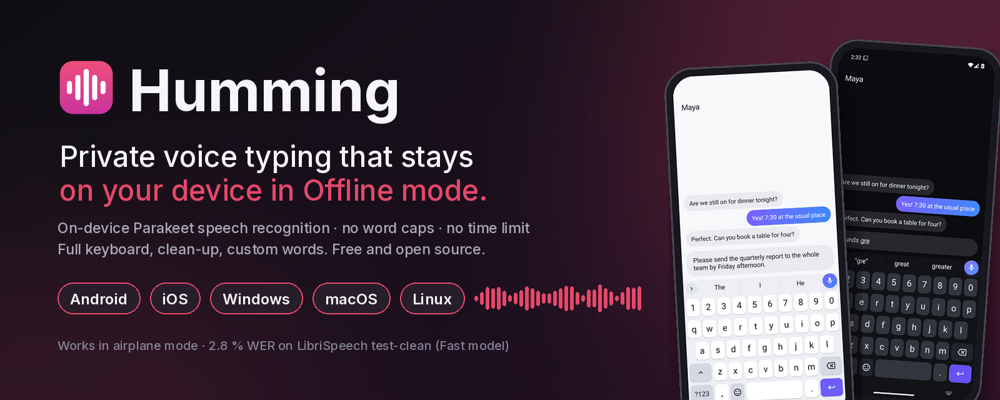</p>

<h1 align="center">Humming Keyboard</h1>

<p align="center"><strong>Talk, and it types. Offline by default: your voice stays on your device.</strong><br>
One project, one version: a private keyboard with offline voice typing for Android, plus iPhone, Windows, macOS
and Linux apps and the website, all built from this repository.</p>

<p align="center">
<a href="https://github.com/muhib-karim/humming-keyboard/releases"></a>
<a href="https://github.com/muhib-karim/humming-keyboard/actions/workflows/keyboard.yml"></a>
<a href="https://github.com/muhib-karim/humming-keyboard/actions/workflows/desktop.yml"></a>
<a href="https://github.com/muhib-karim/humming-keyboard/actions/workflows/ios.yml"></a>
<a href="https://github.com/muhib-karim/humming-keyboard/actions/workflows/release.yml"></a>
<br>
<a href="https://github.com/muhib-karim/humming-keyboard/actions/workflows/android-emulator.yml"></a>
<a href="https://github.com/muhib-karim/humming-keyboard/actions/workflows/quality.yml"></a>
<a href="https://github.com/muhib-karim/humming-keyboard/actions/workflows/codeql.yml"></a>
<a href="docs/ci/COVERAGE.md"></a>
<br>
<a href="#install"></a>
<a href="#benchmarks"></a>
<a href="LICENSE"></a>
</p>

<p align="center">
<a href="https://muhib-karim.github.io/humming-keyboard/"><strong>Website</strong></a> ·
<a href="https://github.com/muhib-karim/humming-keyboard/releases/latest"><strong>Download</strong></a> ·
<a href="docs/USER_GUIDE.md"><strong>User guide</strong></a> ·
<a href="COMPETITORS.md"><strong>Compare</strong></a> ·
<a href="CHANGELOG.md"><strong>Changelog</strong></a> ·
<a href="https://muhib-karim.github.io/humming-keyboard/privacy.html"><strong>Privacy</strong></a>
</p>

| Android: tap, talk, it types | iPhone: talk, clean text | Desktop: hold a shortcut anywhere |
|:---:|:---:|:---:|
|  | 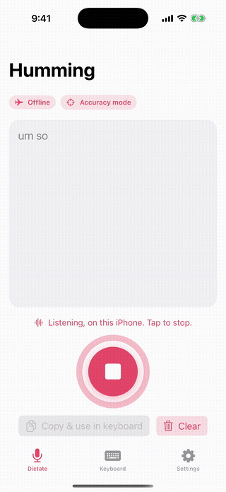 | 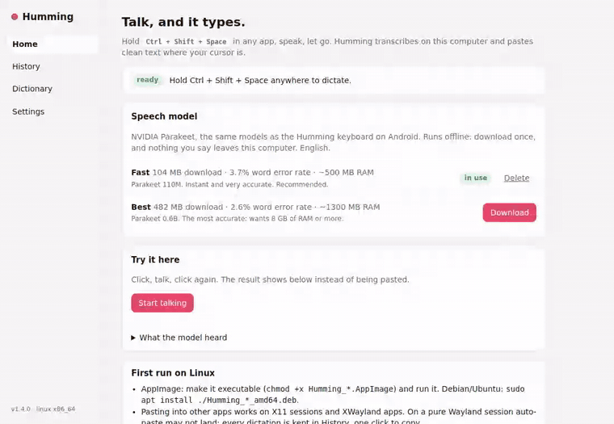 |

<sub>Captures from earlier CI runs (Android emulator in airplane mode, iOS simulator, the desktop interface) playing a
sample sentence, because CI machines have no microphone. Sample text is made up.</sub>

## Highlights

- **Offline by default, on every platform.** NVIDIA Parakeet on sherpa-onnx on Android and desktop; Apple's on-device
  recogniser on iPhone, with on-device recognition required (it refuses to run rather than fall back to a server).
- **No length limit, no word caps, no account.** An hour of dictation works like ten seconds; memory stays flat. On
  desktop no cap is set unless you choose one.
- **Words land as you speak.** An underlined draft corrects itself in place and is typed once when you stop. Dictation
  keeps going with the screen off.
- **Clean text.** Clean mode removes fillers and stutters and applies self-corrections ("3, no, 4pm" → "4pm");
  Accuracy mode also removes hedge fillers. Lists by voice, "scratch that", custom words with spoken → written
  replacements, spoken punctuation and voice commands on all platforms.
- **A full keyboard on Android.** Prediction in six languages with an on-device neural model for English, glide typing,
  emoji search, stickers, clipboard history, themes, one-handed, floating and split layouts. Built on FlorisBoard.
- **Measured accuracy.** 2.78 % (Fast) and 1.68 % (Best) word error rate on LibriSpeech test-clean, with the script
  and raw output in this repository ([Benchmarks](#benchmarks)).
- **Private, and checked in code.** No analytics, no ads. A unit test fails the build if any file outside a short list
  uses a network API ([Privacy](#privacy)).

### New in 1.8: edit by voice, two more speech models, Handy and Amical compared

- **Edit by voice** on Android, iPhone and desktop. Say a whole utterance such as "change Tuesday to Wednesday",
  "delete the word really", "capitalize monday" or "undo that", and Humming edits the text you already have instead of
  typing the words. It only acts when the whole utterance is the command (at most 14 words) and the word you name is
  really there; otherwise the words are typed as normal dictation ("change the oil to synthetic" stays text). One rule
  set in the shared Rust core, ported to Kotlin and Swift, all checked against the same 35 test cases
  (`core/testdata/voice_edit_vectors.json`). On desktop it edits only Humming's own last insertion, in the same app.
  On by default, with a switch ("Edit by voice") on every platform.
- **Two new speech models.** *Multilingual* (NVIDIA Parakeet TDT 0.6B v3, int8) types 25 European languages on Android
  and desktop (phones with 6 GB of memory or more); the English clean-up rules are switched off for it. *Balanced* on
  desktop (Moonshine base, int8) uses less memory than Fast, at slightly lower accuracy and speed. Fast stays the
  default.
- **Every model measured in one run** with the app's own speech engine (LibriSpeech test-clean, first 200 clips): Best
  1.77 %, Multilingual 2.24 %, Fast 2.72 %, Balanced 3.11 %, Lite 4.51 % word error rate, with speed and memory, in
  [docs/BENCHMARKS.md](docs/BENCHMARKS.md).
- **Compared with the open-source desktop apps Handy and Amical** in [COMPETITORS.md](COMPETITORS.md).

### New in 1.7.1: checked on a real Android, measured, gated

No new features; 1.7.1 proves what 1.7.0 does ([changelog](CHANGELOG.md)).

- **An emulator test for every keyboard change** ([`android-emulator.yml`](.github/workflows/android-emulator.yml), on
  pushes and pull requests that touch `keyboard/`): Android 14
  emulator, Humming switched on as the keyboard, its settings opened, "hello" typed by tapping its own keys. The
  screenshots below come from that job, only scaled down.
- **Measured on that emulator**: cold start and voice-model load time ([table](#on-an-android-emulator)).
- **More unit tests** for model download and verification, settings, language switching and each clean-up step:
  line coverage of Humming's own Android code 42.2 % → 48.2 % ([docs/ci/COVERAGE.md](docs/ci/COVERAGE.md)).
- **Quality gates**: ktlint, detekt and Android lint (with baselines of the issues that predate 1.7.1), gitleaks over
  the whole history, CodeQL, Dependabot ([docs/ci/STATIC_ANALYSIS.md](docs/ci/STATIC_ANALYSIS.md)).

### New in 1.7

From the teardowns of [keyboards](COMPETITORS.md#gap-list-ranked) and [dictation apps](COMPETITORS.md#dictation-gap-list-ranked):

- **Dictation like the dictation apps** (Android, desktop, iPhone): say "bullet point" to start a list item, or dictate
  "first, ... second, ..." and get bullets; "scratch that" drops the sentence before it; a custom-words line
  `spoken -> written` replaces what you say (`cube cuddle -> kubectl`, `my sig -> Best, Sam`); filler removal has its
  own switch, on by default.
- **Bangla phonetic typing**: add Bengali with a QWERTY layout and type the way Avro and Ridmik users do
  (`ami bangla likhi` → আমি বাংলা লিখি); space or punctuation types the Bangla word, the Latin word stays one tap away.
- **Dictation that fits the sentence**: dictating into the middle of a line lowercases a common first word, skips the
  space after an opening bracket or quote, and drops the final period when the sentence carries on.
- **More spoken punctuation**: "colon", "semicolon", "open/close quote", "open/close bracket", "ellipsis" and
  "delete last word", the same on Android, desktop and iPhone.
- **Accessibility and security**: AA contrast tokens on every platform, a 48 dp Clean/Verbatim switch with TalkBack
  roles, and the exported "copy to clipboard" share target no longer opens Humming's own files.

## How Humming compares

| | **Humming** | Gboard | Microsoft SwiftKey | Ridmik (Bangla) |
|---|---|---|---|---|
| Offline voice typing | **Yes**, default, every platform (English) | Pixel 6 or later, 6 languages | Not in the stable app; an on-device English mode is reported in a beta | No, uses Google's speech service |
| Published accuracy | **WER 2.78 % / 1.68 %** | Not published | Not published | Not published |
| Telemetry | **None** | Usage statistics; federated learning on by default | Typing data opt-in; voice clips opt-out | Play label: may collect personal info and IDs |
| Voice limits | **None** | Rambler: "usage limits", no numbers | None documented | None documented |
| Desktop app | **Windows, macOS, Linux** | No | No | No |
| Price / ads | **Free, no ads** | Free | Free; ads on Android | Free; ads and IAP on Android |
| Open source | **Apache-2.0** | No | No | No |

Public sources only, checked 17 October 2026; Fleksy, Typewise, Avro, Bijoy and OpenBangla, every source, and the
ranked gap list are in **[COMPETITORS.md](COMPETITORS.md)**. Where Humming trails: offline voice is English only, and
Gboard and SwiftKey support far more typing languages and install from the stores.

| Dictation apps | **Humming** | Wispr Flow | Superwhisper | Aqua Voice | Apple Dictation |
|---|---|---|---|---|---|
| Works offline | **Yes**, default, every platform (English) | No, cloud only | Yes, local models | No, cloud only | On-device in many languages |
| Fillers, lists, "scratch that", replacements | **All four** (1.7) | All four | Fillers, lists, replacements | Replacements | "Delete" / "undo" on iPhone (US English) |
| Edit existing text by voice | No | Command Mode (Pro, desktop) | On selected text | Edit Mode | iPhone, US English |
| Linux | **Yes** | No | "Coming soon" | No | No |
| Price | **Free, no word cap** | Free 2,000 words/week; $15/month | Free with local models; $8.49/month | Free 1,000 words; $10/month | Free with the OS |
| Open source | **Apache-2.0** | No | No | No | No |

Published error rates come from different test sets and are not comparable (Superwhisper 6.6 % on its own 8-set
benchmark, Aqua 5.55 % with the set not stated, Humming 2.78 % on LibriSpeech test-clean). Typeless, Willow, MacWhisper,
Google and every source: **[COMPETITORS.md#dictation-apps](COMPETITORS.md#dictation-apps)**. Where Humming trails the
dictation apps: no voice editing of text already in the field, no per-app tone, and offline dictation is English only.

<details>
<summary><strong>Against dictation apps: Wispr Flow, Typeless, Gboard Rambler</strong></summary>

Checked on the vendors' own pages on 4 October 2026. Prices are per user per month.

| | **Humming** | Wispr Flow | Typeless | Gboard Rambler |
|---|---|---|---|---|
| Works fully offline | **Yes**, every platform | No: "Transcription always occurs on the cloud" [1] | No: uses cloud LLM providers [2] | Limited: offline keeps basic clean-up and punctuation only [12] |
| Where your voice goes | **Stays on the device** (opt-in Online mode on Android uses the phone's speech service) | Wispr's cloud [1] | Cloud, "zero data retention" [2] | Google; "never saved, stored, or shared" [12] |
| Price | **Free**, Apache-2.0 | Free tier; Pro $12-15 [5] | Free tier; Pro $12 yearly / $30 monthly [6] | Free with Gboard |
| Free-tier limit | **None** | 2,000 words/week desktop, 1,000/week mobile [5] | "Limited words" [6] | None stated |
| Longest dictation | **No limit** on Android and iOS (desktop: none by default) | 20 min desktop [7], 5 min Android [8] | 9 min [9] | Not stated |
| Platforms | **Android, iOS, Windows, macOS, Linux** | Mac, Windows, iOS, Android [5] | macOS, Windows, iOS, Android [6] | Pixel 11 phones only [12] |
| Languages | English offline; Online mode: the phone's languages | 100+ [5][10] | 100+ [6] | A listed set of major languages [12] |
| Published WER | **2.78 % / 1.68 %** (LibriSpeech, this repo) | Chart on Wispr's own data, no figures in text [13] | Not published | Not published |

Other offline options: **FUTO Keyboard** (Android, "100% Offline, 100% Private" [16]; its Whisper models were measured
against Parakeet in the bake-off below), **Handy** (desktop, MIT, Whisper or Parakeet [17]) and **Superwhisper**
(states it "works offline"; paid Pro tier [18]).

[1] https://wisprflow.ai/data-controls ·
[2] https://www.typeless.com/data-controls ·
[5] https://wisprflow.ai/pricing ·
[6] https://www.typeless.com/pricing ·
[7] https://docs.wisprflow.ai/articles/4841123325-longer-dictation-sessions-now-up-to-20-minutes ·
[8] https://docs.wisprflow.ai/articles/6391241694-use-flow-hands-free ·
[9] https://www.typeless.com/help/troubleshooting/dictation-limit ·
[10] https://docs.wisprflow.ai/articles/6409258247-supported-languages ·
[12] https://support.google.com/pixelphone/answer/17468539 ·
[13] https://wisprflow.ai/canto ·
[16] https://keyboard.futo.org/ ·
[17] https://github.com/cjpais/Handy ·
[18] https://superwhisper.com/
</details>

## Install

Every file is on the [GitHub Releases page](https://github.com/muhib-karim/humming-keyboard/releases) with a
`SHA256SUMS.txt`. Release candidates (such as 1.7.0-rc1) are marked **pre-release** and are not "latest" until the
final version is published; each release lists exactly which platforms it contains. Step-by-step help for every
platform is in the [user guide](docs/USER_GUIDE.md).

| Platform | File | Install |
|---|---|---|
| **Android** 8.0+ | `Humming-<version>.apk` | Open the APK, allow "install unknown apps" for your browser or file manager, install. Open Humming and follow the two steps (enable the keyboard, switch to it). The first mic tap downloads the Fast speech model once (104 MB). |
| **iPhone / iPad** (iOS 16+) | `Humming_<version>_unsigned.ipa` | Sideload with your own free Apple ID (Sideloadly, AltStore or Xcode; re-sign every 7 days), then add the keyboard in Settings > General > Keyboard. Guide: [docs/IOS_SIDELOAD.md](docs/IOS_SIDELOAD.md). |
| **Windows** 10/11 x64 | `Humming_<version>_x64-setup.exe` or `_x64_en-US.msi` | Run the installer. SmartScreen: **More info** > **Run anyway** (unsigned build). |
| **macOS** 11+ (Apple silicon and Intel) | `Humming_<version>_universal.dmg` | Drag to Applications, open once, then **System Settings > Privacy & Security > Open Anyway**. Allow Microphone and Accessibility. |
| **Linux** x86-64 | `Humming_<version>_amd64.AppImage` or `.deb` | `chmod +x` the AppImage and run it, or `sudo apt install ./Humming_<version>_amd64.deb`. Auto-paste works on X11 and in XWayland apps; on pure Wayland every dictation is kept in History, one click to copy. |

### Verify the Android APK

```sh
sha256sum -c SHA256SUMS.txt --ignore-missing        # the APK's checksum matches the release
apksigner verify --print-certs Humming-<version>.apk  # build-tools; check the signer below
# Signer #1 certificate SHA-256 digest:
# 8c8b68bbe63aa42a856159aaa5b0c90cd954eef78a980d39bcb66941753e1fc6
```

The release workflow checks that the APK and the AAB are both signed with this upload certificate (`8C:8B:68:BB:...:3E:1F:C6`, [docs/RELEASE_SIGNING.md](docs/RELEASE_SIGNING.md)); the in-app
updater refuses an APK signed with any other key.

### Updates

| Platform | What happens |
|---|---|
| Windows, macOS, Linux AppImage | Checks 45 s after start and every 4 hours; installs signed updates (minisign, Ed25519) and restarts, never mid-dictation. Turn automatic installation off in Settings > Updates. |
| Linux .deb | Shows that a new version is out (a .deb cannot replace itself). |
| Android APK | Checks at most every 6 hours; downloads on Wi-Fi, verifies SHA-256 and the signing certificate, then Android asks you to confirm. |
| Android (Play bundle) | Updated by Play; no self-updater, no install permission. |
| iPhone / iPad | No automatic updates for a sideloaded app: sideload the new `.ipa`. |

Feeds (`latest.json`, `android.json`) are written by [`scripts/assemble_release.py`](scripts/assemble_release.py) and
mirrored to `https://humming-keyboard.pages.dev/updates/`; release candidates are not mirrored. How a release is cut:
[docs/RELEASING.md](docs/RELEASING.md).

## Privacy

No account, no analytics, no ads, and no cloud speech engine of Humming's own. Full policy:
[privacy policy](https://muhib-karim.github.io/humming-keyboard/privacy.html) (source:
[play/PRIVACY_POLICY.md](play/PRIVACY_POLICY.md)).

- **The offline voice path has no network code.** `NetworkAuditTest` scans every Kotlin and Java source in the app and
  its libraries and fails the unit tests if any file other than `ModelDownload.kt`, `GifSearch.kt`, `LlmCleanup.kt` and
  `AppUpdate.kt` uses a network API; no voice-path file may import `java.net`. It is a check on the code as written,
  not a firewall at run time.
- **Everything that uses the network:**
  1. the one-time speech model download from the sherpa-onnx GitHub release, checked against a pinned SHA-256 (Wi-Fi
     only if you choose);
  2. the update check of the sideloaded APK (off by default, opt in under Settings > Updates; Android always asks
     before installing) and of the desktop app (on by default); neither sends audio, text or identifiers;
  3. GIF search (off by default, off in incognito unless allowed): only the words typed in its search box, to Openverse;
  4. AI clean-up with your own key (off by default, never in incognito): the dictated **text**, never audio;
  5. Online mode (off by default): hands **audio** to the phone's own speech service. Incognito does not switch it off,
     and neither does a password field: dictating into a password field in Online mode still sends that audio there
     (Humming keeps no history or AI clean-up of it). Use the default offline mode for anything secret.
- **Android backup**: if Android's device backup is on, Android may copy Humming's settings and personal dictionary
  to your Google account; Humming itself sends nothing.
- **iPhone**: Apple's recogniser with on-device recognition required; the iOS app has no network code.

## Benchmarks

**1.8:** every model (Lite, Fast, Balanced, Best, Multilingual) re-measured side by side in one run with the
apps' own engine (sherpa-onnx 1.13.8): word error rate, speed and peak memory are in
[docs/BENCHMARKS.md](docs/BENCHMARKS.md). The figures below are the earlier CI run.

Measured by CI ([`wer-bench.yml`](.github/workflows/wer-bench.yml), run 37204875974 on the 1.4.0 code,
4 October 2026) on LibriSpeech with the exact models and decoder settings the apps ship, on a 2-thread x86-64 CPU
(AMD EPYC 9V74). Lower is better. GitHub has since expired that run's logs, so its output is committed here:
[`docs/bench/ci-37204875974-wer.json`](docs/bench/ci-37204875974-wer.json) and
[`docs/bench/ci-37204875974-bench.log`](docs/bench/ci-37204875974-bench.log).

| Model | WER test-clean (200 clips) | WER test-other (100 clips) | Real-time factor | Median time to text | Model load |
|---|---|---|---|---|---|
| **Fast** (default): Parakeet TDT-CTC 110M int8, 104 MB | **2.78 %** | **4.20 %** | 0.043 (23x real time) | 312 ms clean · 217 ms other | 1.16 s |
| **Best**: Parakeet TDT 0.6B v2 int8, 482 MB | **1.68 %** | **3.12 %** | 0.177 (6x real time) | 1314 ms clean · 937 ms other | 2.13 s |

The sample is fixed (the first 200 test-clean and 100 test-other utterances by ID), so treat the WER as ±0.5 points.
These are desktop-CPU figures; phone speed has not been benchmarked here, so no phone latency is claimed. The
desktop-only Lite model (Moonshine tiny) is not in this benchmark. A re-run outside CI on 8 October 2026 (Fast,
test-clean 200) gave 2.72 %, with every reference and hypothesis in [`docs/bench/`](docs/bench/).

Run it yourself: `python keyboard/ci/fetch_librispeech_sample.py bench test-clean 200`, then
`python keyboard/ci/wer_bench.py <models_dir> bench/LibriSpeech wer.json 200 0` (needs `sherpa-onnx==1.13.8 jiwer soundfile`).

### On an Android emulator

Measured by [`android-emulator.yml`](.github/workflows/android-emulator.yml) run 39713465586 on 22 October 2026 (commit
`33a14bb`), emulator image `system-images;android-34;google_apis;x86_64` on a GitHub-hosted x86-64 runner. The raw
output is committed: [`docs/bench/emulator-run39713465586/`](docs/bench/emulator-run39713465586/).

| Measurement | Result |
|---|---:|
| Cold start to first frame (`am start -W`, release build settings: R8 and resource shrinking; median of 10, after one uncounted launch) | 605 ms (528 to 1,329) |
| Fast voice model, first load (`SherpaEngine`, 2 threads) | 1,017 ms |
| Fast voice model, reload (median of 2) | 867 ms |
| First decode of 1 s of silence | 97 ms |

An emulator on a shared runner is not a phone: use these numbers to compare builds over time, not to predict your
phone. Phone timings are **not measured** here.

| Settings, after the first-run setup | The keyboard opens in the test field | "hello", typed key by key by the test |
|:---:|:---:|:---:|
| 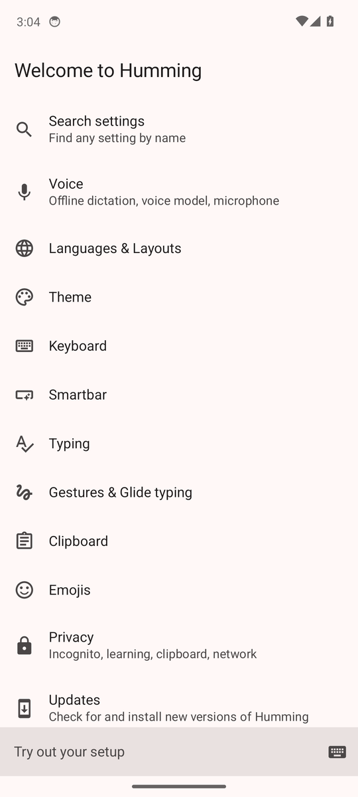 | 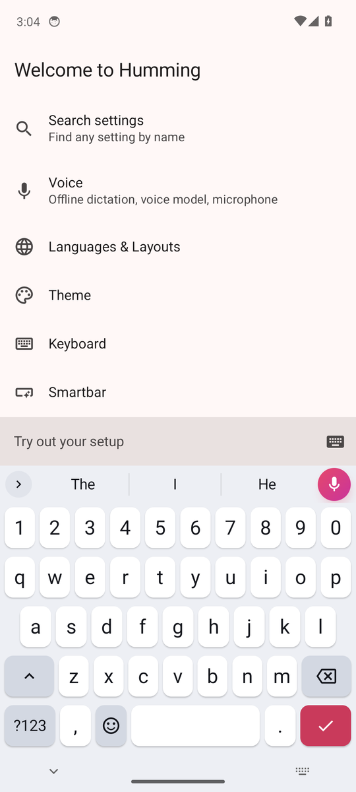 | 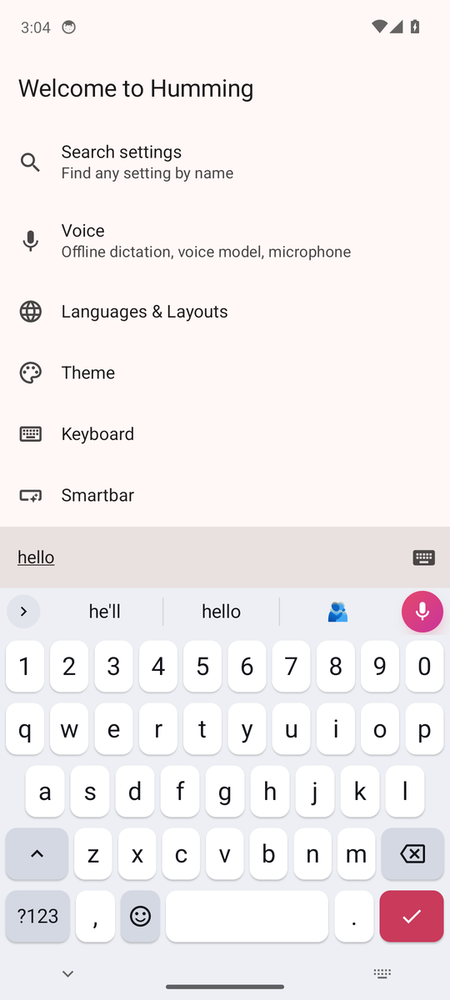 |

<details>
<summary><strong>Why Parakeet: the bake-off</strong></summary>

Same 73 clips for every engine (48 LibriSpeech test-clean, 25 test-other), desktop CPU, 2 threads.

| Engine | WER clean | WER other | WER all | RTF | Download |
|---|---:|---:|---:|---:|---:|
| **Parakeet TDT 0.6B v2 int8 (Humming Best)** | 2.0% | 4.4% | **2.6%** | 0.092 | 482 MB |
| **Parakeet TDT-CTC 110M int8 (Humming Fast)** | 2.6% | 6.6% | **3.7%** | **0.028** | 104 MB |
| FUTO Whisper small.en ACFT q8 | 3.6% | 10.0% | 5.4% | 0.259 | ~260 MB |
| Whisper base.en q8 (whisper.cpp) | 4.4% | 10.7% | 6.1% | 0.228 | 82 MB |
| FUTO Whisper base.en ACFT q8 | 4.5% | 14.1% | 7.1% | 0.072 | 82 MB |
| FUTO Whisper tiny.en ACFT q8 | 7.9% | 16.3% | 10.2% | 0.032 | 44 MB |

A one-off development run whose script and raw outputs are not in this repository: treat it as indicative and use the
CI table above for claims. With 73 clips, gaps under about half a point are noise.
</details>

## Screenshots

| | | |
|---|---|---|
| 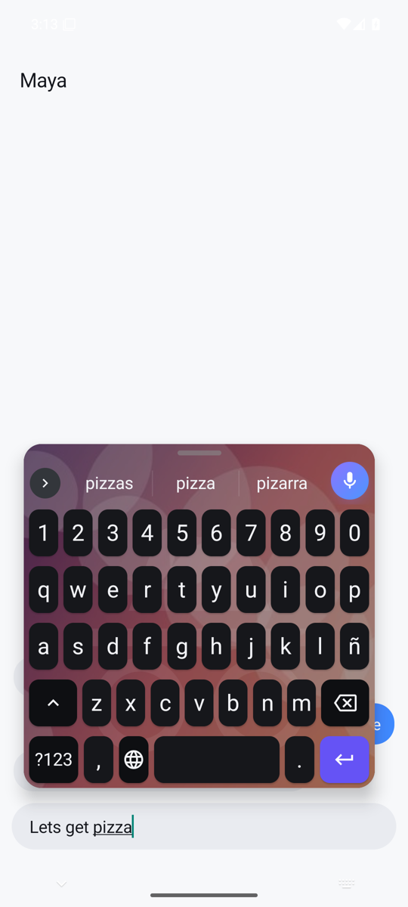 | 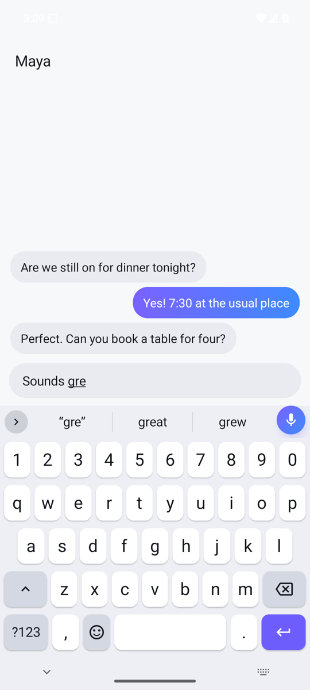 | 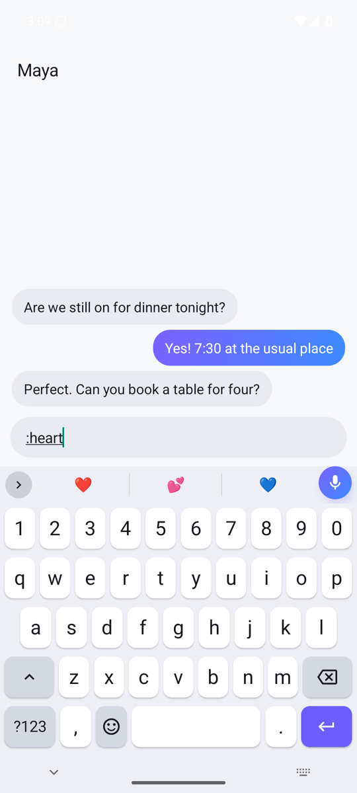 |
| Everything on together | "Sounds gre" → "gre" · **great** · grew | Emoji search `:heart` |
| 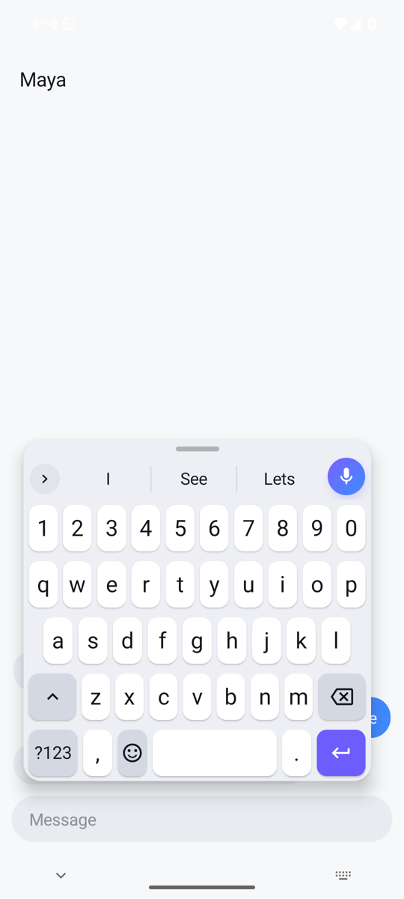 | 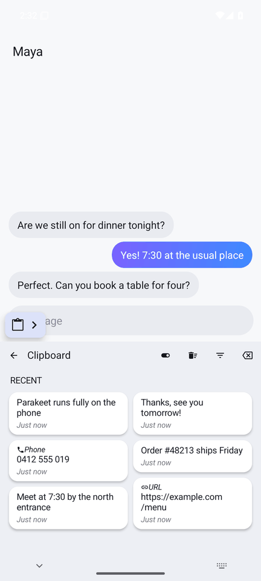 | 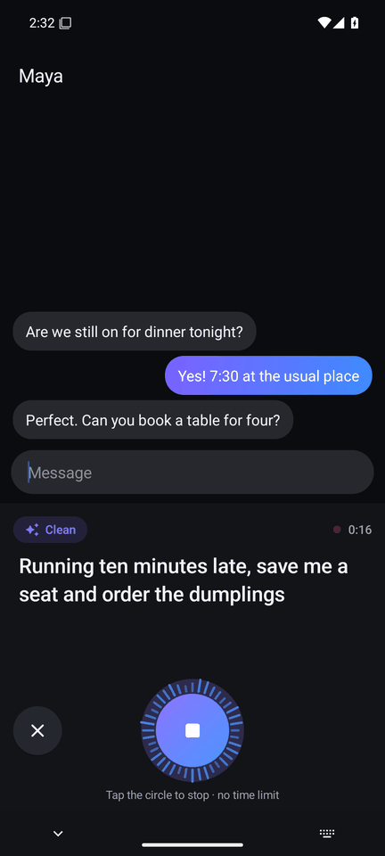 |
| Floating keyboard | Clipboard history | Voice panel (dark) |

<p>
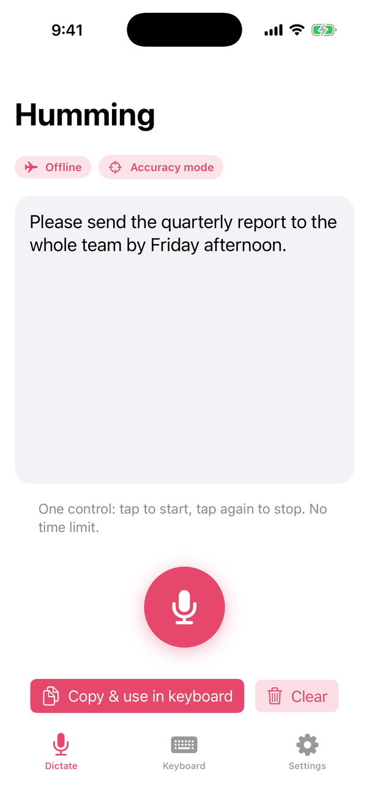
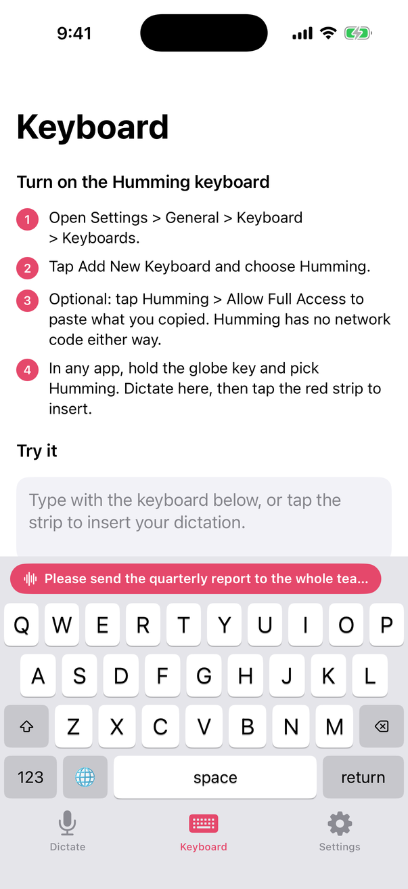
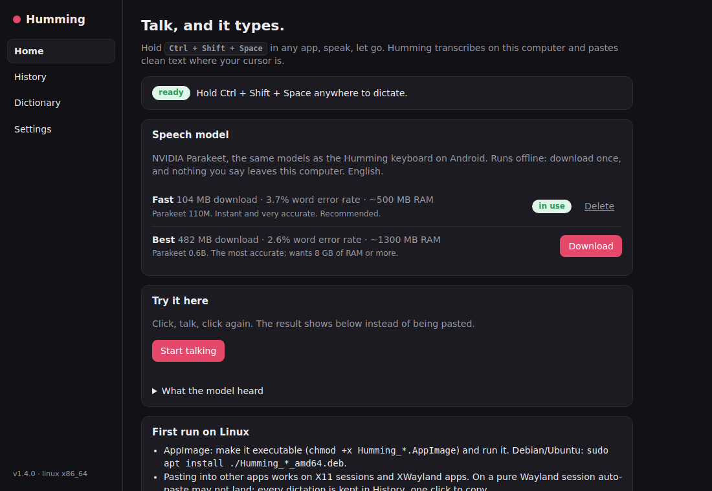
</p>

More: Android, iPhone and desktop captures in [`docs/screenshots/`](docs/screenshots/), the Gboard voice hand-off in
the [user guide](docs/USER_GUIDE.md). The captures above are from CI runs on the 1.3/1.4 builds; the `emulator_*`
captures (including Android's keyboard list and the setup screen) are from the 1.7.1 emulator test.

## Architecture

| Directory | What it is |
|---|---|
| [`keyboard/`](keyboard/) | Android keyboard: a fork of FlorisBoard v0.5.2 (Kotlin, Jetpack Compose). Humming's code is in `com.humming.keyboard`; changes to upstream are listed in [`keyboard/NOTICE-HUMMING.md`](keyboard/NOTICE-HUMMING.md). |
| [`desktop/`](desktop/) | Windows, macOS and Linux app (Tauri v2: Rust back end, TypeScript UI). |
| [`ios/`](ios/) | iPhone and iPad app and keyboard extension (SwiftUI), clean-up rules as the `HummingCore` Swift package. |
| [`core/`](core/) | Shared Rust crate (VAD, audio helpers, clean-up, spoken lists; optional whisper.cpp). |
| [`play/`](play/) | Website (`play/site/`, GitHub Pages), privacy policy, Google Play listing material. |
| [`scripts/`](scripts/) | Release assembly, update-signature verification, site assembly and checks (Python). |
| [`docs/`](docs/) | Documentation, screenshots, benchmark outputs, audits. |

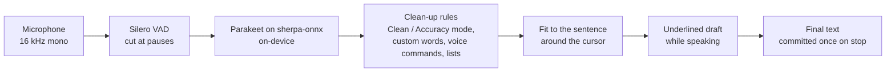

The Android dictation path, traced from the source (every box links to its code in the
[interactive version](docs/android-architecture.html); open it from a clone, GitHub shows HTML as source):

<picture>
  <source media="(prefers-color-scheme: dark)" srcset="docs/images/android-architecture-dark.png">
  
</picture>

Every module, the dictation pipeline step by step, the update channel and CI: [docs/ARCHITECTURE.md](docs/ARCHITECTURE.md).
A file-level map: [docs/ci/CODEBASE_MAP.md](docs/ci/CODEBASE_MAP.md).

| Area | Technology |
|---|---|
| Android | Kotlin, Jetpack Compose, FlorisBoard v0.5.2, sherpa-onnx 1.13.8, Silero VAD v4, min SDK 26, target SDK 36 |
| Speech models | NVIDIA Parakeet TDT-CTC 110M int8 (Fast), Parakeet TDT 0.6B v2 int8 (Best); desktop also Moonshine tiny (Lite) |
| Prediction | Dictionaries and next-word tables for six languages, an int8 word-level LSTM run by Humming's own Kotlin code |
| Desktop | Tauri v2, Rust (sherpa-onnx, cpal, arboard, enigo, tauri-plugin-updater), TypeScript + Vite |
| iOS | SwiftUI, Apple Speech with on-device recognition required, XcodeGen, Swift package `HummingCore` |
| Release and CI | GitHub Actions, Python release scripts, GitHub Pages and Cloudflare Pages |

## Build from source

Requirements and every platform in detail: the per-app READMEs and [docs/RELEASING.md](docs/RELEASING.md).

```sh
# Android (JDK 17, Android SDK platform 36, build-tools 35)
cd keyboard
./gradlew :app:testDebugUnitTest      # unit tests
./gradlew :app:assembleDebug          # debug APK in app/build/outputs/apk/debug/

# Desktop (Node 20+, Rust stable, the platform toolchain)
cd desktop && npm ci && npm run tauri dev

# iOS (macOS, Xcode 16+)
brew install xcodegen && cd ios && xcodegen generate && open Humming.xcodeproj
cd ios/HummingCore && swift test      # clean-up rules, also on Linux
```

The sherpa-onnx Android library is downloaded once during the build and checked against a pinned SHA-256; speech
models are not in the APK. Without the release-signing environment variables, the release build is signed with the
development key ([docs/RELEASE_SIGNING.md](docs/RELEASE_SIGNING.md)).

CI (`.github/workflows/`): `keyboard.yml` (Android unit tests with coverage, Android lint, APKs),
`android-emulator.yml` (smoke test and measurements on an emulator), `quality.yml` (ktlint, detekt, gitleaks, site
check), `codeql.yml`, `android-release.yml` (signed APK and AAB),
`desktop.yml` (installers for every desktop platform), `ios.yml` (tests, screenshots, unsigned `.ipa`), `screens.yml`,
`wer-bench.yml`, `release.yml` (a tagged release end to end) and `pages.yml` (website and update mirror).

## Documentation

| Document | Contents |
|---|---|
| [docs/USER_GUIDE.md](docs/USER_GUIDE.md) | Install, enable the keyboard, voice typing, settings, updates, troubleshooting |
| [COMPETITORS.md](COMPETITORS.md) | Teardown against Gboard, SwiftKey, Fleksy, Typewise, Ridmik, Avro, Bijoy and the dictation apps (Wispr Flow, Typeless, Superwhisper, Aqua Voice, Willow, MacWhisper, Apple, Google); ranked gap lists |
| [docs/ARCHITECTURE.md](docs/ARCHITECTURE.md) | Modules, the dictation pipeline, the update channel, CI |
| [docs/BRAND.md](docs/BRAND.md) | Colours, icon, design tokens across Android, desktop, iOS and the site |
| [docs/RELEASING.md](docs/RELEASING.md) | Versioning, signing, release assets, update feeds, tagging |
| [docs/ci/STATIC_ANALYSIS.md](docs/ci/STATIC_ANALYSIS.md) | Every CI quality gate, and how the lint baselines were made |
| [docs/BENCHMARKS.md](docs/BENCHMARKS.md) | Every speech model measured side by side (1.8): word error rate, speed, memory |
| [docs/TESTING_v1.8.md](docs/TESTING_v1.8.md) | What was tested for 1.8, with commands and results |
| [docs/ci/COVERAGE.md](docs/ci/COVERAGE.md) | Unit-test coverage before and after 1.7.1, and what the new tests cover |
| [docs/IOS_SIDELOAD.md](docs/IOS_SIDELOAD.md) | Installing the unsigned iOS build |
| [docs/README.md](docs/README.md) | Index of all documentation, audits and CI notes |

## Contributing and security

- [CONTRIBUTING.md](CONTRIBUTING.md): bugs, features and pull requests.
- [SECURITY.md](SECURITY.md): report vulnerabilities privately through GitHub Security Advisories.
- [CODE_OF_CONDUCT.md](CODE_OF_CONDUCT.md): Contributor Covenant 2.1.

## Tech stack

- **Android keyboard:** Kotlin, Jetpack Compose, Room, built on FlorisBoard
- **Desktop app:** Tauri (Rust) with a TypeScript + Vite frontend
- **Shared core:** Rust (Cargo)
- **Tests and CI:** JUnit, `cargo test`, GitHub Actions

## Licence and credits

Humming is licensed under the **Apache License 2.0** ([`LICENSE`](LICENSE), [`NOTICE`](NOTICE)), covering the whole
repository: the Android keyboard (`keyboard/`, which keeps the FlorisBoard copy in
[`keyboard/LICENSE`](keyboard/LICENSE)), the desktop app, the shared core and the iOS app. The repository is public
from the 1.6.3 release.

- **FlorisBoard** (Apache-2.0): the keyboard base. Copyright (C) 2020-2025 The FlorisBoard Contributors; upstream
  licence and headers kept, changes listed in [`keyboard/NOTICE-HUMMING.md`](keyboard/NOTICE-HUMMING.md). Humming is not
  affiliated with the FlorisBoard project. Android keyboard built on FlorisBoard (Apache 2.0).
- **NVIDIA Parakeet** TDT-CTC 110M and TDT 0.6B v2: model weights under **CC-BY-4.0**
  (https://creativecommons.org/licenses/by/4.0/); ONNX int8 export by the sherpa-onnx project, used unmodified.
- **sherpa-onnx** (Apache-2.0, k2-fsa): the speech runtime. **ONNX Runtime** (MIT), **Silero VAD** (MIT), Apache
  Commons Compress (Apache-2.0), the AOSP word lists (Apache-2.0).
- Prediction data: **Tatoeba** sentences (CC BY 2.0 FR) and **Mozilla Common Voice** sentence lists (CC0); only
  aggregated counts and the English neural model `hlm_en.bin` (trained on them; Tatoeba's attribution applies) ship.
- Stickers: rendered from **Noto Emoji** (Apache-2.0) with captions in **Bangers** (OFL-1.1).
- Bangla phonetic rules: written for Humming from the common Avro-style conventions; no Avro code or rule data is
  included.

No GPL code is included in the Android app. [`keyboard/LICENSES.md`](keyboard/LICENSES.md) lists each third-party
component of the Android keyboard; for the desktop app, core and iOS app the dependencies and licences are those
declared in `desktop/src-tauri/Cargo.toml`, `desktop/package.json`, `core/Cargo.toml` and their lock files.
