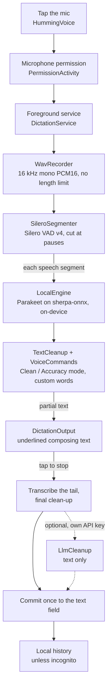
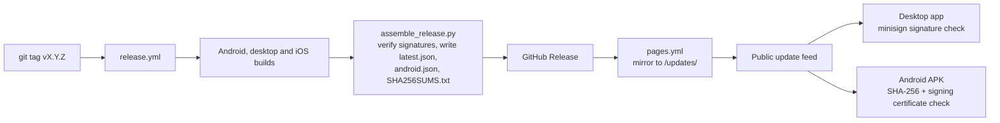

# Architecture

Humming is three apps in one repository, Android, desktop and iOS, that share the same idea: record on the device,
recognise speech on the device, clean the text up with the same rules, and type it where the cursor is. Android and
desktop run the same speech models (NVIDIA Parakeet on sherpa-onnx 1.13.8, pinned by SHA-256); iOS uses Apple's
on-device recogniser.

- [Repository layout](#repository-layout)
- [Dictation pipeline (Android)](#dictation-pipeline-android)
- [Desktop and iOS](#desktop-and-ios)
- [Network boundaries](#network-boundaries)
- [Update channel](#update-channel)
- [CI and release workflows](#ci-and-release-workflows)

## Repository layout

| Path | Contents |
|---|---|
| `keyboard/` | The Android keyboard, a fork of FlorisBoard v0.5.2 (Kotlin, Jetpack Compose; Gradle build, version in `keyboard/gradle.properties`). Upstream code stays in `dev.patrickgold.florisboard`; Humming's voice engine, prediction model and updater are in `keyboard/app/src/main/kotlin/com/humming/keyboard/`. Changes to upstream: [`keyboard/NOTICE-HUMMING.md`](../keyboard/NOTICE-HUMMING.md). |
| `keyboard/ci/` | The word-error-rate benchmark (`wer_bench.py`) and the LibriSpeech sample fetcher. |
| `desktop/` | The Windows, macOS and Linux app: Tauri v2 with a Rust back end (`src-tauri/src/`) and a TypeScript + Vite UI without a framework (`src/`). See [`desktop/README.md`](../desktop/README.md). |
| `ios/` | The iPhone / iPad app (`App/`, SwiftUI), the keyboard extension (`Keyboard/`), code shared between them (`Shared/`) and the clean-up rules as a Swift package (`HummingCore/`). The Xcode project is generated from `project.yml` by XcodeGen. |
| `core/` | `humming-core`, a Rust crate from the first desktop prototype: VAD, audio helpers, clean-up and an optional whisper.cpp engine, with optional UniFFI bindings. The desktop app depends on it without whisper.cpp (energy VAD and spoken-list formatting). Interface: [`core/INTERFACE.md`](../core/INTERFACE.md). |
| `play/` | The website source (`play/site/`: home page and privacy policy, published to GitHub Pages by `pages.yml`), the privacy policy in Markdown, and Google Play listing material (data safety, content rating, graphics, store text). |
| `landing/` | A static App Links landing page with `.well-known/assetlinks.json` (not published yet; see `landing/README.md`) and the icon the website uses. |
| `scripts/` | `assemble_release.py` (builds a release folder, update feeds and checksums) and `verify_updater.py` (checks update signatures against the app's public key). |
| `docs/` | This documentation, screenshots, benchmark outputs (`docs/bench/`), audits and the desktop screenshot script (`docs/ci/`). |
| `.github/workflows/` | CI, release and website workflows (listed [below](#ci-and-release-workflows)). |

## Dictation pipeline (Android)

1. **Start.** Tapping the mic in the Smartbar opens the voice panel (`ime/voice/HummingVoice.kt`). A keyboard cannot
   show permission dialogs, so the microphone permission goes through a transparent activity
   (`PermissionActivity`). If the phone's CPU is not one the engine is built for (`arm64-v8a`, `x86_64`), the panel
   says "Voice isn't available on this device" instead of starting.
2. **Keep running.** `DictationService` is a foreground service of type `microphone` with a partial wake lock and a
   "Humming is listening" notification, so capture and recognition continue with the screen off or in another app.
3. **Capture.** `WavRecorder` records 16 kHz mono PCM16 and streams every block onward. Only the start of the audio is
   kept in memory (for History's retry), so memory stays flat however long you talk.
4. **Segment.** `StreamingSession` feeds the stream to `SileroSegmenter` (Silero VAD v4 through sherpa-onnx, cutting
   at pauses of 0.4 s and at most every 12 s). If Silero cannot load, the pure-Kotlin energy `Segmenter` is used.
5. **Recognise.** Each finished segment is transcribed on a background thread while you keep talking, by
   `LocalEngine` (Parakeet Fast or Best through sherpa-onnx on the CPU; `CoreLoader` loads the model once and picks
   the thread count from the phone's performance cores). Models are listed in `VoiceModels.kt`.
6. **Clean up.** `TextCleanup` removes non-speech, fillers and stutters, handles spoken punctuation, self-corrections
   ("3, no, 4pm" → "4pm"), repeated words, dictionary casing, capitals and final punctuation. `VoiceCommands`
   applies "scratch that" and similar. Custom words can be limited to particular apps (`AppVocabulary`).
7. **Show.** `DictationOutput` shows the cleaned text so far as composing text (the underlined draft) and replaces it
   in place with every new partial; nothing is committed while you talk. With "Live text while speaking" off,
   nothing is shown until you stop.
8. **Finish.** On stop, `StreamingSession.finish()` transcribes only the audio after the last pause, so the text lands
   quickly even after a long dictation. If AI clean-up is on (your own key, not in incognito), the finished text
   goes to `LlmCleanup`; any failure keeps the on-device text. The final text is committed once.

Online mode (opt-in) replaces steps 3 to 5 with `OnlineSession`, which uses Android's own speech recogniser
service and restarts it after each pause. Test mode (`MockTranscriber`) runs only when set on purpose in a debuggable
build (`Prefs.resolveMode`).

Most of the rules above are pure Kotlin without Android types, so they are covered by JVM unit tests (for example
`TextCleanupTest`, `SegmenterTest`, `VoiceCommandsTest`, `ModePolicyTest`).

## Desktop and iOS

**Desktop** (`desktop/src-tauri/src/`): `lib.rs` holds the app state, the global shortcut, the dictation flow and the
tray. `audio.rs` captures the microphone with cpal (mono f32, live level for the overlay). `stt.rs` runs the
sherpa-onnx recogniser and splits long audio into windows of at most 25 s cut at the quietest point. `text_cleanup.rs`
is a Rust port of the Android `TextCleanup.kt` rules, with tests. `insert.rs` pastes into the focused app (clipboard
plus Ctrl/Cmd+V, clipboard restored) or types key by key. `models.rs` downloads and verifies the models,
`settings.rs` and `history.rs` keep JSON files in the app's folders, and `updater.rs` drives the signed self-update.

**iOS** (`ios/`): the app records and recognises with Apple's Speech framework with on-device recognition required, so
it refuses to run rather than fall back to a server. Text goes through the Swift port of the clean-up rules
(`HummingCore/Sources/HummingCore/TextCleanup.swift`). iOS keyboards cannot use the microphone, so the app hands the
result to the keyboard extension through shared storage (`Shared/SharedStore.swift`), and the keyboard inserts it.

## Network boundaries

On Android, `NetworkAuditTest` (a unit test) fails the unit-test run if any source file other than these four uses a network
API, and checks that no voice-path file imports `java.net`:

| File | Network use | Default |
|---|---|---|
| `ModelDownload.kt` | One-time speech model download from the sherpa-onnx GitHub release, checked against a pinned SHA-256 | When you choose a model; Wi-Fi only optional |
| `AppUpdate.kt` | Update feed and APK download (sideloaded APK only) | On |
| `GifSearch.kt` | GIF search words to Openverse | Off |
| `LlmCleanup.kt` | Finished dictated text to Gemini, OpenAI or Groq with your own key | Off |

Online mode hands audio to the phone's own speech service; Humming's code does not send it anywhere. The iOS app has
no network code. The desktop app downloads its models and checks for updates.

## Update channel

- **Feeds.** `latest.json` (Tauri updater format, one signed entry per desktop platform) and `android.json`
  (`versionCode`, `versionName`, APK name, SHA-256, notes) are written by `scripts/assemble_release.py` with
  `SHA256SUMS.txt` over every release file.
- **Mirror.** The apps read their feeds from a mirror of the release files: `AppUpdate.FEED_BASE` and the
  desktop updater endpoint in `desktop/src-tauri/tauri.conf.json` point at https://humming-keyboard.pages.dev/updates/.
  `pages.yml` also copies the latest release's update files to the GitHub Pages site's `/updates/` and checks the
  live feed's signatures with `scripts/verify_updater.py`.
- **Desktop.** `tauri-plugin-updater` installs only files signed with Humming's minisign (Ed25519) update key; the
  public key is `plugins.updater.pubkey` in `tauri.conf.json`.
- **Android.** `AppUpdate` downloads a newer APK, compares its SHA-256 with `SHA256SUMS.txt`, requires the release
  signing certificate and the expected package name and version code, and hands it to Android's PackageInstaller,
  which asks the user to confirm. The Google Play bundle is built with `-Phumming.play=true` and has no updater and no
  `REQUEST_INSTALL_PACKAGES` permission.

Release steps are in [RELEASING.md](RELEASING.md); keys in [RELEASE_SIGNING.md](RELEASE_SIGNING.md).

## CI and release workflows

| Workflow | Runs on | Does |
|---|---|---|
| `keyboard.yml` | Changes under `keyboard/` | Android unit tests (including `NetworkAuditTest`), debug APK, release APK |
| `android-release.yml` | Changes under `keyboard/` (push to `main` or pull request), by hand, or from `release.yml` | Signed release APK and Play AAB; checks the signing certificate |
| `desktop.yml` | Changes under `desktop/` or `core/`, or from `release.yml` | Type-check and unit tests, installers for macOS, Windows and Linux with `SHA256SUMS.txt` |
| `ios.yml` | Changes under `ios/`, or from `release.yml` | Swift tests on Linux and the iOS simulator, screenshots, unsigned `.ipa` |
| `screens.yml` | Desktop UI changes | Desktop screenshots and walkthrough GIF (artifacts only) |
| `wer-bench.yml` | By hand, or changes to the benchmark script | The LibriSpeech word-error-rate benchmark quoted in the README |
| `release.yml` | A pushed `v*` tag | Every platform build, `assemble_release.py`, the GitHub Release, then `pages.yml` |
| `pages.yml` | Website changes on `main`, by hand, or from `release.yml` | Publishes `play/site/` to GitHub Pages and mirrors the latest release's update files |

GitHub Actions has not started jobs on this repository since 5 October 2026 (account billing); releases since 1.6.0
were built outside Actions, as described in [CHANGELOG.md](../CHANGELOG.md).
